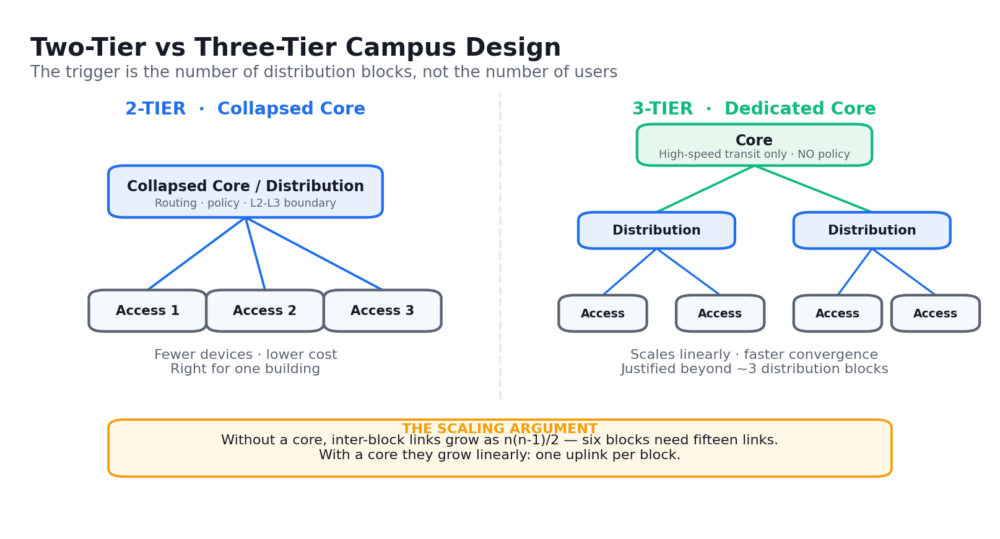
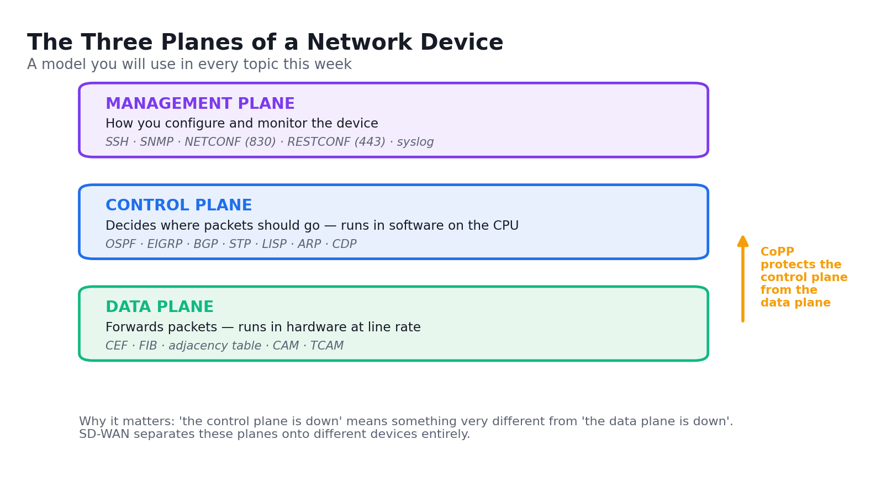
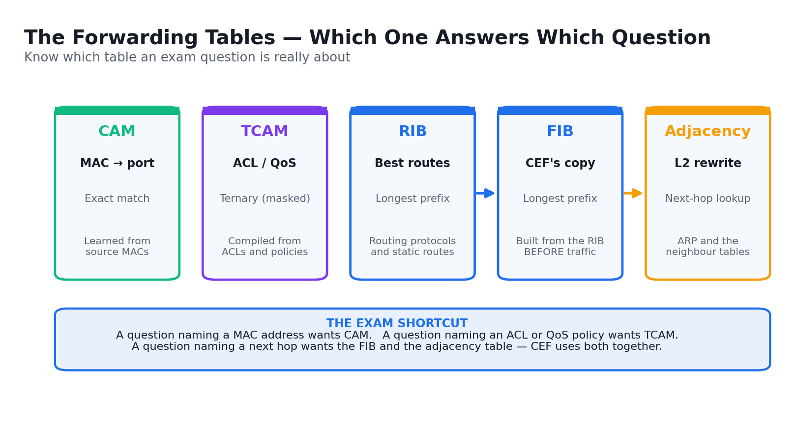
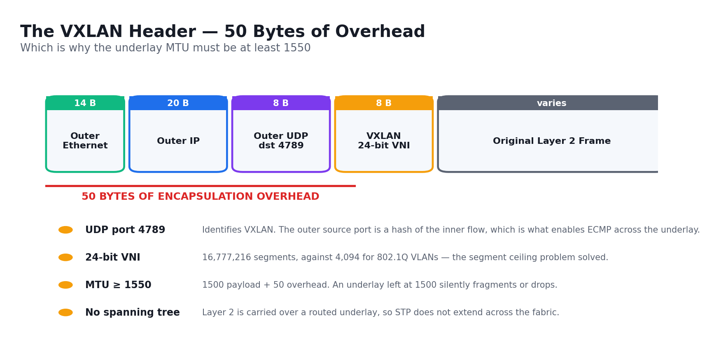
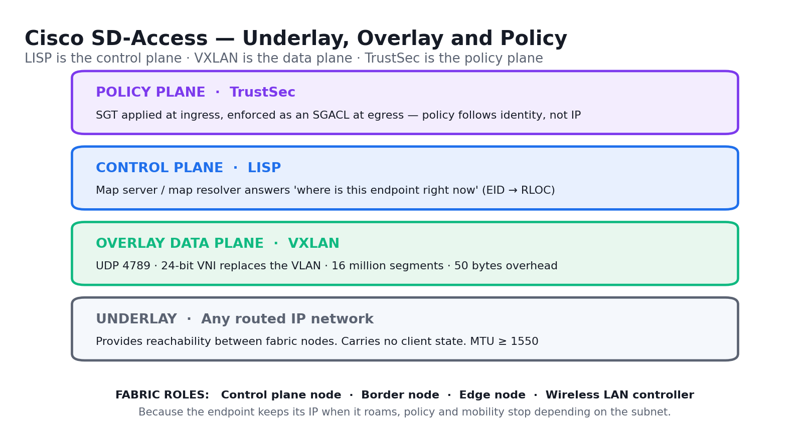
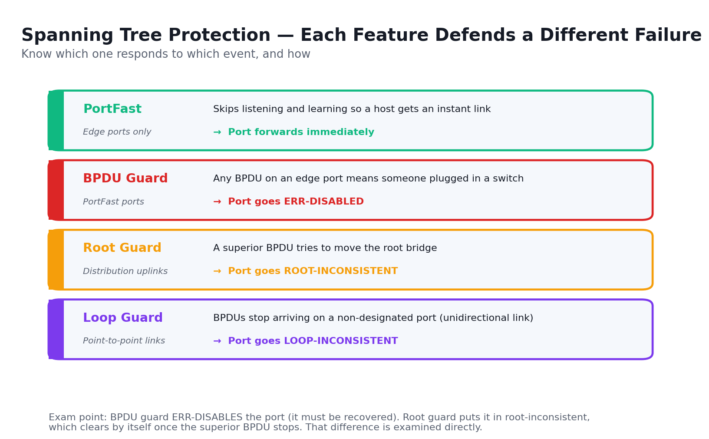
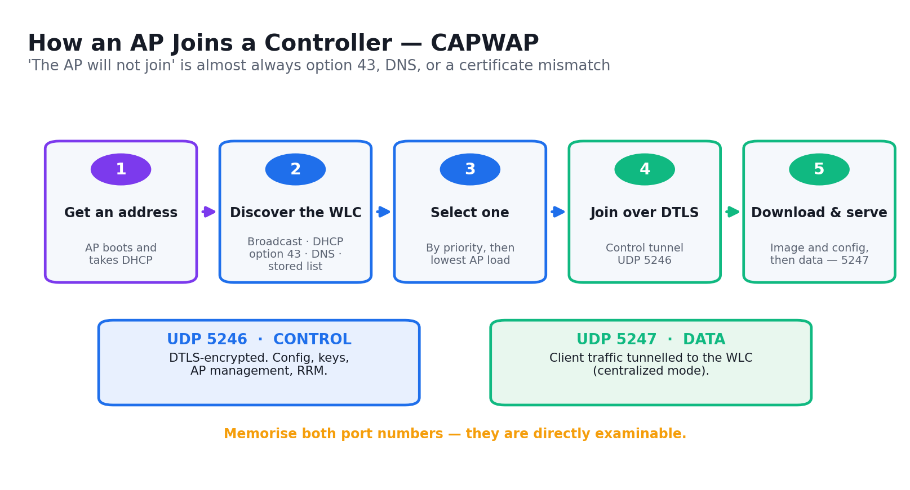
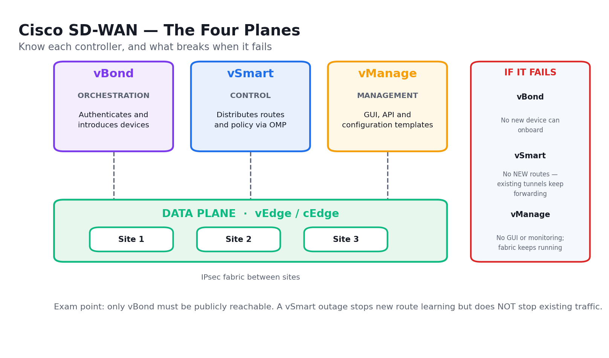
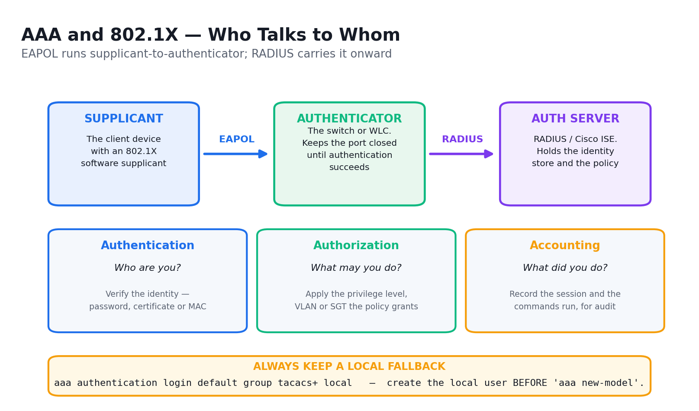

# Cisco Certified Network Professional (CCNP) for ENCOR Training — Learner Guide

**WSQ Course Code:** TGS-2024044052  |  **Conducted by:** Tertiary Infotech Academy Pte Ltd (UEN 201200696W)  |  **Version v6.0 · 7 September 2026**

## Contents

- [Introduction](#introduction)
- [Course Learning Outcomes](#course-learning-outcomes)
- [The ENCOR 350-401 Exam Blueprint](#the-encor-350-401-exam-blueprint)
- [Before You Start — Lab Environment Setup](#before-you-start--lab-environment-setup)
- [Topic 01 — Enterprise Architecture  (15%)](#topic-01--enterprise-architecture--15)
  - [Lab 1 — Investigate the CAM and TCAM Tables](#lab-1--investigate-the-cam-and-tcam-tables)
  - [Lab 2 — Analyse Cisco Express Forwarding](#lab-2--analyse-cisco-express-forwarding)
  - [Lab 3 — Compare Two-Tier and Three-Tier Campus Designs](#lab-3--compare-two-tier-and-three-tier-campus-designs)
  - [Lab 4 — Interpret Wired and Wireless QoS Configurations](#lab-4--interpret-wired-and-wireless-qos-configurations)
  - [Lab 5 — Explore SD-WAN and SD-Access Architecture](#lab-5--explore-sd-wan-and-sd-access-architecture)
- [Topic 02 — Virtualization Technologies  (10%)](#topic-02--virtualization-technologies--10)
  - [Lab 6 — Configure and Verify VRF-Lite](#lab-6--configure-and-verify-vrf-lite)
  - [Lab 7 — Configure and Verify a GRE Tunnel](#lab-7--configure-and-verify-a-gre-tunnel)
  - [Lab 8 — Configure and Verify a Site-to-Site IPsec VPN](#lab-8--configure-and-verify-a-site-to-site-ipsec-vpn)
  - [Lab 9 — Explore LISP and VXLAN Network Virtualization](#lab-9--explore-lisp-and-vxlan-network-virtualization)
- [Topic 03 — Network Infrastructure  (30%)](#topic-03--network-infrastructure--30)
  - [Lab 10 — Troubleshoot 802.1Q Trunking and DTP](#lab-10--troubleshoot-8021q-trunking-and-dtp)
  - [Lab 11 — Troubleshoot Static and Dynamic EtherChannels](#lab-11--troubleshoot-static-and-dynamic-etherchannels)
  - [Lab 12 — Configure RSTP and Tune the Spanning Tree](#lab-12--configure-rstp-and-tune-the-spanning-tree)
  - [Lab 13 — Configure Multiple Spanning Tree (MST)](#lab-13--configure-multiple-spanning-tree-mst)
  - [Lab 14 — Harden the Spanning Tree with PortFast, BPDU Guard and Root Guard](#lab-14--harden-the-spanning-tree-with-portfast-bpdu-guard-and-root-guard)
  - [Lab 15 — Compare EIGRP and OSPF Path Selection](#lab-15--compare-eigrp-and-ospf-path-selection)
  - [Lab 16 — Configure Multiarea OSPFv2 with Summarization and Filtering](#lab-16--configure-multiarea-ospfv2-with-summarization-and-filtering)
  - [Lab 17 — Configure Multiarea OSPFv3 for IPv6](#lab-17--configure-multiarea-ospfv3-for-ipv6)
  - [Lab 18 — Configure and Verify eBGP](#lab-18--configure-and-verify-ebgp)
  - [Lab 19 — Configure a Basic WLAN and WPA2-Enterprise on the WLC](#lab-19--configure-a-basic-wlan-and-wpa2-enterprise-on-the-wlc)
  - [Lab 20 — Troubleshoot WLAN and Wireless Client Connectivity](#lab-20--troubleshoot-wlan-and-wireless-client-connectivity)
  - [Lab 21 — Configure NTP, NAT/PAT and HSRP](#lab-21--configure-ntp-natpat-and-hsrp)
- [Topic 04 — Network Assurance  (10%)](#topic-04--network-assurance--10)
  - [Lab 22 — Diagnose Network Problems with Ping, Traceroute and Conditional Debug](#lab-22--diagnose-network-problems-with-ping-traceroute-and-conditional-debug)
  - [Lab 23 — Configure Syslog, SNMP and Flexible NetFlow](#lab-23--configure-syslog-snmp-and-flexible-netflow)
  - [Lab 24 — Configure SPAN, RSPAN and IP SLA](#lab-24--configure-span-rspan-and-ip-sla)
  - [Lab 25 — Configure NETCONF and RESTCONF and Explore DNA Center Workflows](#lab-25--configure-netconf-and-restconf-and-explore-dna-center-workflows)
- [Topic 05 — Network Security  (20%)](#topic-05--network-security--20)
  - [Lab 26 — Configure Secure Device Access with SSH and Strong Passwords](#lab-26--configure-secure-device-access-with-ssh-and-strong-passwords)
  - [Lab 27 — Implement Local and Server-Based AAA](#lab-27--implement-local-and-server-based-aaa)
  - [Lab 28 — Configure Extended ACLs to Mitigate Attacks](#lab-28--configure-extended-acls-to-mitigate-attacks)
  - [Lab 29 — Configure Control Plane Policing](#lab-29--configure-control-plane-policing)
  - [Lab 30 — Analyse Wireless Security, REST API Security and Security Design](#lab-30--analyse-wireless-security-rest-api-security-and-security-design)
- [Topic 06 — Network Automation  (15%)](#topic-06--network-automation--15)
  - [Lab 31 — Interpret Python Components and Scripts](#lab-31--interpret-python-components-and-scripts)
  - [Lab 32 — Construct and Validate JSON-Encoded Files](#lab-32--construct-and-validate-json-encoded-files)
  - [Lab 33 — Explore YANG Models and Call the DNA Center API](#lab-33--explore-yang-models-and-call-the-dna-center-api)
  - [Lab 34 — Construct an EEM Applet to Automate Response](#lab-34--construct-an-eem-applet-to-automate-response)
  - [Lab 35 — Compare Agent and Agentless Orchestration Tools](#lab-35--compare-agent-and-agentless-orchestration-tools)
- [Exam Focus — Cross-Cutting Topics](#exam-focus--cross-cutting-topics)
- [Exam Preparation](#exam-preparation)
- [Glossary](#glossary)


## Introduction

This Learner Guide accompanies the WSQ course Cisco Certified Network Professional (CCNP) for ENCOR Training (TGS-2024044052), conducted by Tertiary Infotech Academy Pte Ltd. It provides detailed, step-by-step instructions for all 35 hands-on labs, organised by the six official exam domains of Cisco 350-401 ENCOR v1.1 — Implementing Cisco Enterprise Network Core Technologies. Every lab maps to a published exam objective and is completed in Cisco Packet Tracer using the Cisco IOS command line, so the commands you learn here transfer directly to real Catalyst switches and ISR/Catalyst routers.

Use this guide alongside the course slides and the lab folders in labs/ of the course repository. Each lab folder contains its own topology file, addressing table and mock data set. The slides carry the concepts, the diagrams and the verification criteria; this guide carries the full procedure with every command. Work through the steps in order — later steps depend on the state earlier ones create.

All configuration in this course is performed in a simulated lab environment. When you apply these techniques to a production network, follow your organisation's change-management process: take a configuration backup first, schedule the change, and have a documented rollback. Several commands in this guide — clearing a MAC table, shutting an interface, applying an ACL or a CoPP policy — will interrupt live traffic if run on a production device.


## Course Learning Outcomes

- LO1: Translate organizational networking needs into technical configurations by selecting appropriate network components, considering their functions and interdependencies.
- LO2: Identify and choose key network components for configuration, utilizing techniques in server and device implementation aligned with technical requirements.
- LO3: Implement a variety of servers and devices effectively, following the organizational network blueprint to enhance network performance and reliability.
- LO4: Manage network access, ensuring compliance with organizational guidelines and specifications to maintain secure and efficient user connectivity.
- LO5: Select and deploy network management tools effectively, optimizing network performance and user experience in line with organizational needs.
- LO6: Conduct regular network reporting and administration, employing assessment tools to ensure network stability and alignment with organizational objectives.


## The ENCOR 350-401 Exam Blueprint

This course is built directly on the Cisco 350-401 ENCOR v1.1 exam blueprint. The six topics are the six exam domains, in the same order and with the same weightings, so time spent in class is proportional to time spent in the exam. The official topic list is published at https://learningnetwork.cisco.com/s/encor-exam-topics.

- Topic 01 — Enterprise Architecture (ENCOR domain 1.0 Architecture) — 15% of the exam. Design principles · wireless design · SD-WAN · SD-Access · QoS · switching mechanisms.
- Topic 02 — Virtualization Technologies (ENCOR domain 2.0 Virtualization) — 10% of the exam. Hypervisors · virtual machines · virtual switching · VRF · GRE and IPsec · LISP and VXLAN.
- Topic 03 — Network Infrastructure (ENCOR domain 3.0 Infrastructure) — 30% of the exam. Layer 2 · Layer 3 routing · wireless · IP services — the largest exam domain.
- Topic 04 — Network Assurance (ENCOR domain 4.0 Network Assurance) — 10% of the exam. Diagnostics · NetFlow · SPAN/RSPAN/ERSPAN · IP SLA · DNA Center · NETCONF and RESTCONF.
- Topic 05 — Network Security (ENCOR domain 5.0 Security) — 20% of the exam. Device access control · AAA · ACLs and CoPP · REST API security · wireless security · security design.
- Topic 06 — Network Automation (ENCOR domain 6.0 Automation) — 15% of the exam. Python · JSON · YANG · DNA Center and vManage APIs · REST responses · EEM · orchestration tools.

The exam runs 120 minutes and is the core exam for both CCNP Enterprise and CCIE Enterprise. Passing it alone earns the Cisco Certified Specialist – Enterprise Core certification; CCNP Enterprise additionally requires one concentration exam such as ENARSI.

**Read the verb in each objective**

- Configure and verify — you must know the configuration commands AND the show command that proves it worked.
- Troubleshoot — you are given a broken configuration and must find and fix it; the labs marked 'Troubleshoot' start broken on purpose.
- Describe — conceptual only; the exam will not ask you for a command, but it will ask you what a component does.
- Interpret — you are shown a configuration, a script or an output and asked to predict the result.
- Compare — you must state the differences and, usually, choose one for a given scenario.


## Before You Start — Lab Environment Setup

**What you need**

- Cisco Packet Tracer 8.2+ — The primary lab environment. Every .pkt/.pka topology in labs/ opens in Packet Tracer — free from the Cisco Networking Academy.
- Cisco IOS / IOS XE CLI — All configuration is done at the IOS CLI, so the commands transfer directly to real 9200/9300 switches and ISR/CSR routers.
- Wireless LAN Controller (WLC) — The Packet Tracer WLC GUI is used for the WLAN, WPA2-Enterprise and wireless troubleshooting labs.
- Python 3.10+ — Used for the automation labs — interpreting scripts, parsing JSON and calling REST APIs.
- Postman or curl — Used to exercise the Cisco DNA Center and RESTCONF APIs and to read response codes.
- A text editor — VS Code or any editor for writing Python scripts, JSON payloads and saved configurations.

**Install and verify Cisco Packet Tracer**

Packet Tracer is free from the Cisco Networking Academy (netacad.com). Create a free account, download the release for your operating system, install it, and sign in on first launch — Packet Tracer requires a Networking Academy login before it will open a topology file.

```bash
# Verify your install before Day 1:
#  1. Launch Cisco Packet Tracer and sign in with your NetAcad account
#  2. File > Open, and open any .pkt file from the labs/ folder
#  3. Click a router, then the CLI tab — you should get a prompt
#  4. Press Enter, then type 'enable' to reach privileged EXEC mode
```

**The lab folder layout**

Every lab in this course has its own folder under labs/, containing the topology file, a README with the procedure, the addressing table, and the mock data set (CSV) the lab works with. Open the folder before you start the lab and keep the addressing table visible — most configuration errors in these labs are an address or an interface typed from memory rather than read from the table.

```bash
labs/
  README.md                     the lab index
  tools.md                      the tool reference for the whole course
  lab-01-cam-tcam/
    README.md                   objectives, scenario, full step-by-step, validation
    lab-01-cam-tcam.pkt         the Packet Tracer topology
    addressing-table.csv        every device, interface and address
    *.csv                       the lab's mock data set
```

**Cisco IOS CLI conventions used throughout this guide**

- Router> is user EXEC mode. Type 'enable' to reach privileged EXEC (Router#), where the show commands live.
- Router# is privileged EXEC. Type 'configure terminal' to reach global configuration (Router(config)#).
- Router(config)# is global configuration. 'interface g0/0' moves to interface configuration (Router(config-if)#).
- 'exit' moves up one level; 'end' or Ctrl-Z returns to privileged EXEC from anywhere.
- Commands can be abbreviated to the shortest unique string — 'sh ip int br' is 'show ip interface brief'. This guide spells them in full so you learn the real command.
- Tab completes a command; '?' lists what may come next. Both work at every level and are the fastest way to recover when you are unsure.
- 'copy running-config startup-config' (or 'write memory') saves your work. A reload without it discards everything you configured.

**Recovering when a lab goes wrong**

- 'show running-config' shows what is actually configured — compare it against the step you thought you ran.
- 'show ip interface brief' is the fastest health check: an interface that is administratively down needs 'no shutdown'.
- To remove any command, retype it with 'no' in front: 'no ip address', 'no router ospf 10'.
- If a topology is beyond repair, close it without saving and reopen the .pkt file to return to the starting state.


## Topic 01 — Enterprise Architecture  (15%)

Design principles · wireless design · SD-WAN · SD-Access · QoS · switching mechanisms.

Exam domain: ENCOR domain 1.0 Architecture. Skills Framework mapping: K1, A1 of TSC Network Configuration (ICT-DIT-3009-1.1).

**Key concepts**

- Enterprise campus designs are layered: a 2-tier (collapsed core) design merges core and distribution and suits a single building, while a 3-tier design keeps a dedicated core and is justified once you exceed roughly three distribution blocks.
- The access layer terminates end devices and enforces port security, PoE and QoS trust; the distribution layer aggregates and is the boundary where Layer 2 becomes Layer 3; the core is a high-speed, low-latency transit fabric that must never run policy.
- High availability is delivered in three planes: redundancy of hardware and links, FHRP (HSRP, VRRP, GLBP) for default-gateway resilience, and SSO/NSF so a supervisor failover does not tear down routing adjacencies.
- Wireless deployment models trade control against latency — centralized (all traffic tunnelled to a WLC), distributed/FlexConnect (locally switched at the branch), controller-less (Mobility Express), cloud-managed (Meraki) and remote branch.
- Location services (RSSI trilateration, Angle of Arrival with Hyperlocation, BLE beacons) drive asset tracking and analytics; accuracy depends on AP density and placement, not on client radio power.
- Client density planning is a capacity problem, not a coverage problem: high-density areas need smaller cells, lower AP transmit power, narrower channel widths and band steering to 5 GHz.
- Cisco SD-WAN separates a control plane (vSmart), an orchestration plane (vBond), a management plane (vManage) and a data plane (vEdge/cEdge) — OMP distributes routes and policy, and IPsec builds the fabric.
- Cisco SD-Access builds a VXLAN overlay on any IP underlay: the control plane is LISP (map server / map resolver), the data plane is VXLAN, and policy is carried as SGTs enforced by TrustSec.
- QoS components are classification and marking (DSCP/CoS), queuing and scheduling (LLQ/CBWFQ), congestion avoidance (WRED), policing (drops) and shaping (buffers) — mark once, at the trust boundary, and act everywhere.
- Wireless QoS maps DSCP to the 802.11e user-priority (WMM) access categories; a mismatch between the wired DSCP and the wireless UP is the most common reason voice quality collapses over Wi-Fi.
- Hardware switching is a table story: CAM is exact-match (MAC address table), TCAM is ternary and stores masked entries for ACLs and QoS, the FIB is the CEF-prepared copy of the RIB, and the adjacency table holds the rewrite information.
- Cisco Express Forwarding replaces process and fast switching by building the FIB and adjacency table ahead of traffic — so the first packet of a flow is switched in hardware just like the millionth.



*Two-tier versus three-tier campus design — the decision is driven by the number of distribution blocks.*



*The three planes of a network device — the model used throughout this course.*



*The forwarding tables: which one answers which question.*


### Lab 1 — Investigate the CAM and TCAM Tables

Exam objective: Describe hardware switching mechanisms such as CAM, TCAM, FIB, RIB and adjacency tables (ENCOR 1.6).

Scenario: You take the role of a campus network engineer verifying how an access switch actually forwards a frame. You generate traffic between hosts, watch the MAC address table (CAM) populate by learning source addresses, then age an entry out and observe the switch flood the unknown unicast. You finish by inspecting how TCAM stores the masked ACL and QoS entries that CAM's exact-match lookup cannot hold.

**What you'll build**

A documented CAM table showing dynamically learned entries, one static entry you added, and a written comparison of CAM versus TCAM lookup behaviour.

**Tools and devices**

Cisco Packet Tracer, Cisco IOS CLI, S1/S2 access switches, PC-A and PC-B.

**Step-by-step**

1. Open lab-01-cam-tcam/lab-01-cam-tcam.pkt and confirm PC-A (192.168.10.10) and PC-B (192.168.10.20) are in VLAN 10
2. Clear the switch MAC address table so you start from a known empty state

   ```bash
   S1# clear mac address-table dynamic
   ```

3. Display the empty table and note that only the CPU entries remain

   ```bash
   S1# show mac address-table
   ```

4. From PC-A, ping PC-B to make the switch learn both source MAC addresses

   ```bash
   C:\> ping 192.168.10.20
   ```

5. Display the CAM table again and record the two dynamic entries, their VLAN and their ports

   ```bash
   S1# show mac address-table dynamic
   ```

6. Show the ageing time — the timer that removes an entry when a host goes quiet

   ```bash
   S1# show mac address-table aging-time
   ```

7. Add a static CAM entry so PC-A's MAC is pinned to F0/1 and never ages out

   ```bash
   S1(config)# mac address-table static 000c.1234.5678 vlan 10 interface FastEthernet0/1
   ```

8. Verify the static entry appears with type STATIC, not DYNAMIC

   ```bash
   S1# show mac address-table static
   ```

9. Count the total entries the switch is currently holding

   ```bash
   S1# show mac address-table count
   ```

10. Apply an ACL so the switch programs masked entries into TCAM rather than CAM

   ```bash
   S1(config)# access-list 10 permit 192.168.10.0 0.0.0.255
   ```

11. Inspect the platform TCAM utilisation to see the ACL and QoS regions

   ```bash
   S1# show platform tcam utilization
   ```

12. Write two sentences in your notes explaining why an ACL cannot live in CAM

**Validation — test it**

'show mac address-table dynamic' lists both PC MAC addresses against the correct ports and VLAN 10, 'show mac address-table static' shows your pinned entry, and you can state that CAM does exact-match on MAC while TCAM does masked match for ACL/QoS.

> **Note:** The topology file, addressing table and mock data for this lab are in labs/lab-01-*/ . Configuration commands change device state — on a production network, back up the configuration and follow change management before running them.

---


### Lab 2 — Analyse Cisco Express Forwarding

Exam objective: Describe and verify CEF, the FIB and the adjacency table, and contrast them with process and fast switching (ENCOR 1.6).

Scenario: Continuing as the campus engineer, you now move up to Layer 3 and prove how the router forwards in hardware. You examine the RIB, then the FIB that CEF builds from it ahead of any traffic, then the adjacency table that holds the Layer 2 rewrite. You disable CEF to watch forwarding fall back to process switching, observe the CPU cost, and re-enable it.

**What you'll build**

A side-by-side record of the RIB, the FIB and the adjacency table for one destination prefix, plus measured evidence of the CPU difference when CEF is disabled.

**Tools and devices**

Cisco Packet Tracer, Cisco IOS CLI, R1 and R2 routers, PC-A and PC-B.

**Step-by-step**

1. Open lab-02-cef/lab-02-cef.pkt and confirm R1 G0/0 is 192.168.10.1 and the R1–R2 link is 10.1.1.0/30
2. Display the routing table (the RIB) — the control plane's view of the network

   ```bash
   R1# show ip route
   ```

3. Display the FIB that CEF has pre-built from that RIB

   ```bash
   R1# show ip cef
   ```

4. Look at one specific prefix in the FIB and note its next hop and outgoing interface

   ```bash
   R1# show ip cef 192.168.20.0
   ```

5. Display the adjacency table holding the Layer 2 rewrite string for that next hop

   ```bash
   R1# show adjacency detail
   ```

6. Confirm CEF is enabled globally and per interface

   ```bash
   R1# show ip interface brief | include Protocol
   ```

7. Baseline the CPU before you change anything

   ```bash
   R1# show processes cpu sorted | include CPU
   ```

8. Disable CEF globally to force process switching

   ```bash
   R1(config)# no ip cef
   ```

9. Generate sustained traffic from PC-A to PC-B and observe the CPU climb

   ```bash
   C:\> ping 192.168.20.10 -n 100
   ```

10. Re-check the CPU utilisation and record the difference

   ```bash
   R1# show processes cpu sorted | include CPU
   ```

11. Re-enable CEF and confirm the FIB is repopulated

   ```bash
   R1(config)# ip cef
   ```

12. Verify the FIB is back and traffic is switched in hardware again

   ```bash
   R1# show ip cef summary
   ```


**Validation — test it**

'show ip cef' returns a populated FIB and 'show adjacency detail' shows a valid rewrite for the next hop; with CEF disabled you can point to a measurably higher CPU figure during the ping, and it falls again once CEF is re-enabled.

> **Note:** The topology file, addressing table and mock data for this lab are in labs/lab-02-*/ . Configuration commands change device state — on a production network, back up the configuration and follow change management before running them.

---


### Lab 3 — Compare Two-Tier and Three-Tier Campus Designs

Exam objective: Explain enterprise design principles including 2-tier, 3-tier, fabric and cloud designs (ENCOR 1.1.a).

Scenario: A 400-staff company on one campus is merging with a 2,000-staff company across four buildings. As the design engineer you must recommend a campus architecture for the merged organisation. You document the current 2-tier collapsed-core design, model the merged requirement, and justify whether a dedicated core layer is now warranted — the exact judgement the exam tests.

**What you'll build**

A completed design comparison table and a one-page written recommendation stating whether to move to a 3-tier design, with the trigger conditions that justify it.

**Tools and devices**

Cisco Packet Tracer, network diagram, design decision worksheet.

**Step-by-step**

1. Open lab-03-campus-design/lab-03-campus-design.pkt and identify which switches are access and which are distribution
2. Record what each layer is doing today — port security and PoE at access, routing at distribution

   ```bash
   SW-DIST-1# show ip route
   ```

3. Confirm the distribution layer is the Layer 2 to Layer 3 boundary by checking the SVIs

   ```bash
   SW-DIST-1# show ip interface brief | include Vlan
   ```

4. Count the distribution blocks the merged network will need (one per building)
5. Apply the design rule: a dedicated core is justified beyond roughly three distribution blocks
6. Calculate the full-mesh link count without a core — n(n-1)/2 for four blocks
7. Complete the comparison table in design-comparison.csv for cost, cabling, convergence and scalability
8. Document where high availability belongs — redundant supervisors, links, FHRP and SSO/NSF
9. State which layer must never carry policy, and why the core stays simple and fast
10. Write your recommendation with the trigger conditions that would justify the change

**Validation — test it**

Your recommendation names 3-tier for the merged network, shows the full-mesh link count that falls from six inter-block links to four uplinks once a core is added, and states that the core layer carries no ACLs or policy.

> **Note:** The topology file, addressing table and mock data for this lab are in labs/lab-03-*/ . Configuration commands change device state — on a production network, back up the configuration and follow change management before running them.

---


### Lab 4 — Interpret Wired and Wireless QoS Configurations

Exam objective: Interpret wired and wireless QoS configurations, including QoS components and QoS policy (ENCOR 1.5).

Scenario: Voice calls on the campus wireless network are breaking up during busy periods. As the network engineer you trace the QoS treatment of a voice packet end to end: you read the classification and marking at the wired trust boundary, examine the queuing policy, then check how DSCP maps to the 802.11e WMM access category on the wireless side — where the mismatch usually is.

**What you'll build**

A documented end-to-end QoS policy showing the class map, policy map and service policy, plus the DSCP-to-WMM mapping table that explains the voice degradation.

**Tools and devices**

Cisco Packet Tracer, Cisco IOS CLI, R1 router, SW-1 switch, WLC.

**Step-by-step**

1. Open lab-04-qos/lab-04-qos.pkt and locate the IP phone, the access switch and the WAN router
2. Display the class maps that classify traffic into voice, video and best effort

   ```bash
   R1# show class-map
   ```

3. Display the policy map that assigns bandwidth and priority to each class

   ```bash
   R1# show policy-map
   ```

4. Identify the low-latency queue reserved for voice — the strict-priority queue

   ```bash
   R1# show policy-map interface Serial0/0/0
   ```

5. Read the marking: voice should carry DSCP EF (46), call signalling CS3 (24), video AF41 (34)

   ```bash
   R1# show policy-map interface | include dscp
   ```

6. Check the trust boundary on the access port where the phone connects

   ```bash
   SW-1# show mls qos interface FastEthernet0/1
   ```

7. Confirm the switch trusts the DSCP the phone marks rather than remarking it

   ```bash
   SW-1# show mls qos interface FastEthernet0/1 | include trust
   ```

8. Inspect the queuing and drop behaviour under congestion

   ```bash
   R1# show policy-map interface Serial0/0/0 | include drops
   ```

9. Record the DSCP to 802.11e user-priority mapping — EF should map to WMM Voice (UP 6)
10. Identify in qos-policy-map.csv which class is mismarked and explain the audio symptom it causes

**Validation — test it**

You can trace a voice packet from the phone's EF marking, through the trusted access port, into the priority queue on the WAN interface, and state which DSCP-to-WMM mapping is wrong and why calls break up.

> **Note:** The topology file, addressing table and mock data for this lab are in labs/lab-04-*/ . Configuration commands change device state — on a production network, back up the configuration and follow change management before running them.

---


### Lab 5 — Explore SD-WAN and SD-Access Architecture

Exam objective: Explain the working principles of the Cisco SD-WAN and SD-Access solutions and their control and data plane elements (ENCOR 1.3, 1.4).

Scenario: Your organisation is evaluating both Cisco SD-WAN for its branch WAN and SD-Access for its campus. As the architect you must be able to name every plane element and say what breaks if it fails. You map the four SD-WAN planes and the SD-Access LISP/VXLAN/TrustSec stack, then work through failure scenarios that the exam poses as 'what happens if…' questions.

**What you'll build**

Two completed architecture maps — SD-WAN's four planes and SD-Access's control/data/policy planes — plus a failure-impact table for each component.

**Tools and devices**

Cisco Packet Tracer, architecture worksheet, sdwan-components.csv, sdaccess-components.csv.

**Step-by-step**

1. Open lab-05-sdwan-sdaccess/ and read the two topology diagrams provided
2. Map the SD-WAN orchestration plane to vBond and state what it does — authenticates and introduces devices
3. Map the control plane to vSmart and note it distributes routes and policy over OMP, never carrying data
4. Map the management plane to vManage — the GUI, API and configuration templates
5. Map the data plane to the vEdge/cEdge routers that build the IPsec fabric between sites
6. Answer the failure question: if vSmart fails, existing data plane tunnels keep forwarding but no new routes are learned
7. Move to SD-Access and identify the underlay — any routed IP network providing reachability
8. Identify the overlay data plane as VXLAN and note the VNI replaces the VLAN as the segment identifier
9. Identify the control plane as LISP, with the map server and map resolver resolving EID to RLOC
10. Identify the policy plane as TrustSec, carrying SGTs enforced as SGACLs at egress
11. Name the fabric roles: control plane node, border node, edge node and wireless LAN controller
12. Complete the failure-impact table for each component in both architectures

**Validation — test it**

You can name all four SD-WAN planes with their controller, state that a vSmart outage stops new route learning but not existing forwarding, and correctly identify LISP as the SD-Access control plane and VXLAN as its data plane.

> **Note:** The topology file, addressing table and mock data for this lab are in labs/lab-05-*/ . Configuration commands change device state — on a production network, back up the configuration and follow change management before running them.

---


## Topic 02 — Virtualization Technologies  (10%)

Hypervisors · virtual machines · virtual switching · VRF · GRE and IPsec · LISP and VXLAN.

Exam domain: ENCOR domain 2.0 Virtualization. Skills Framework mapping: K2, A2 of TSC Network Configuration (ICT-DIT-3009-1.1).

**Key concepts**

- A Type 1 (bare-metal) hypervisor such as ESXi, KVM or Hyper-V runs directly on the hardware and is what data centres deploy; a Type 2 hypervisor such as VMware Workstation or VirtualBox runs as an application on a host OS and suits a lab.
- A virtual machine packages vCPU, vRAM, vNIC and virtual disk with a full guest OS — heavier than a container but fully isolated, which is why network functions (CSR 1000v, ASAv, WLC-v) ship as VMs.
- Virtual switching (vSwitch, Cisco Nexus 1000v, DVS) moves the access layer inside the hypervisor: VM-to-VM traffic on the same host never touches a physical switch, which is exactly why it can bypass your physical ACLs.
- VRF (Virtual Routing and Forwarding) creates multiple independent routing tables on one device — the same IP prefix can exist in two VRFs without conflict, giving Layer 3 segmentation without extra hardware.
- VRF-Lite is VRF without MPLS: you define the VRF, assign interfaces with 'vrf forwarding', and every show/ping/traceroute must then be qualified with 'vrf <name>' or it consults the global table and appears to fail.
- GRE tunnels are simple, multiprotocol and support routing protocols and multicast — but they provide no confidentiality, integrity or authentication whatsoever.
- IPsec provides confidentiality, integrity, authentication and anti-replay; the classic enterprise pattern is GRE over IPsec, which gives you the routing and multicast support of GRE plus the protection of IPsec.
- IPsec negotiates in two phases: IKE Phase 1 builds a bidirectional management tunnel (ISAKMP SA), and Phase 2 builds the unidirectional IPsec SAs that actually carry data — an interesting-traffic ACL mismatch is the classic Phase 2 failure.
- LISP splits location from identity: an EID identifies the endpoint and an RLOC identifies where it currently attaches, with a map server / map resolver providing the lookup — this is what makes SD-Access mobility work.
- VXLAN encapsulates a Layer 2 frame in UDP (port 4789) and carries it across a routed underlay, extending Layer 2 without spanning tree and lifting the segment ceiling from 4,094 VLANs to 16 million VNIs.



*The VXLAN header — 50 bytes of overhead, which is why the underlay MTU must be at least 1550.*



*Cisco SD-Access: LISP control plane, VXLAN data plane, TrustSec policy plane.*


### Lab 6 — Configure and Verify VRF-Lite

Exam objective: Configure and verify data path virtualization technologies — VRF (ENCOR 2.2.a).

Scenario: Your organisation must keep guest traffic and corporate traffic completely separate on the same physical router, and the acquisition it just completed uses the same 192.168.1.0/24 range as head office. As the network engineer you solve both problems with VRF-Lite: two independent routing tables on one device, with overlapping address space and no leaking between them.

**What you'll build**

A router carrying two VRFs (CORP and GUEST) with overlapping 192.168.1.0/24 prefixes, proven isolated by a VRF-aware ping that succeeds inside a VRF and fails across VRFs.

**Tools and devices**

Cisco Packet Tracer, Cisco IOS CLI, R1 router, CORP-PC and GUEST-PC.

**Step-by-step**

1. Open lab-06-vrf-lite/lab-06-vrf-lite.pkt and note both PCs use 192.168.1.10 in different VRFs
2. Create the CORP VRF on R1

   ```bash
   R1(config)# vrf definition CORP
   ```

3. Enable IPv4 address family inside the VRF

   ```bash
   R1(config-vrf)# address-family ipv4
   ```

4. Create the GUEST VRF the same way

   ```bash
   R1(config)# vrf definition GUEST
   ```

5. Assign G0/0 to the CORP VRF — note this clears any existing IP address

   ```bash
   R1(config-if)# vrf forwarding CORP
   ```

6. Now add the address to the CORP interface

   ```bash
   R1(config-if)# ip address 192.168.1.1 255.255.255.0
   ```

7. Assign G0/1 to the GUEST VRF and give it the identical address

   ```bash
   R1(config-if)# vrf forwarding GUEST
   ```

8. Add the overlapping address to the GUEST interface

   ```bash
   R1(config-if)# ip address 192.168.1.1 255.255.255.0
   ```

9. List the VRFs and confirm each owns its interface

   ```bash
   R1# show vrf
   ```

10. Display the CORP routing table — it must be separate from the global table

   ```bash
   R1# show ip route vrf CORP
   ```

11. Display the GUEST routing table and confirm the same prefix appears independently

   ```bash
   R1# show ip route vrf GUEST
   ```

12. Ping inside the CORP VRF — this must succeed

   ```bash
   R1# ping vrf CORP 192.168.1.10
   ```

13. Ping the same address without a VRF keyword and observe it consult the empty global table and fail

   ```bash
   R1# ping 192.168.1.10
   ```


**Validation — test it**

'show vrf' lists CORP and GUEST with their interfaces, both VRF routing tables carry 192.168.1.0/24 independently, 'ping vrf CORP' succeeds, and the unqualified ping fails — proving isolation rather than a broken configuration.

> **Note:** The topology file, addressing table and mock data for this lab are in labs/lab-06-*/ . Configuration commands change device state — on a production network, back up the configuration and follow change management before running them.

---


### Lab 7 — Configure and Verify a GRE Tunnel

Exam objective: Configure and verify data path virtualization technologies — GRE tunneling (ENCOR 2.2.b).

Scenario: Head office and the branch are connected only across the public internet, but the routing protocol and multicast traffic they need to exchange cannot cross it. As the WAN engineer you build a GRE tunnel that carries those private networks over the public path, then demonstrate the critical limitation the exam always tests: GRE gives you transport, not confidentiality.

**What you'll build**

A working GRE tunnel between RA (64.103.211.2) and RB (209.165.122.2) carrying 192.168.1.0/24 and 192.168.2.0/24, verified up/up with traffic passing.

**Tools and devices**

Cisco Packet Tracer, Cisco IOS CLI, RA and RB routers, PCA and PCB.

**Step-by-step**

1. Open lab-07-gre/lab-07-gre.pkt and confirm RA and RB can reach each other over their public addresses

   ```bash
   RA# ping 209.165.122.2
   ```

2. Create the tunnel interface on RA

   ```bash
   RA(config)# interface Tunnel0
   ```

3. Give the tunnel its own private address in the 10.10.10.0/30 transit range

   ```bash
   RA(config-if)# ip address 10.10.10.1 255.255.255.252
   ```

4. Set the tunnel source to RA's public interface

   ```bash
   RA(config-if)# tunnel source Serial0/0/0
   ```

5. Set the tunnel destination to RB's public address

   ```bash
   RA(config-if)# tunnel destination 209.165.122.2
   ```

6. Confirm the mode is GRE over IP, which is the IOS default

   ```bash
   RA(config-if)# tunnel mode gre ip
   ```

7. Repeat on RB with the mirrored addresses

   ```bash
   RB(config-if)# ip address 10.10.10.2 255.255.255.252
   ```

8. Set RB's tunnel source and destination back towards RA

   ```bash
   RB(config-if)# tunnel destination 64.103.211.2
   ```

9. Add a static route on RA sending the remote LAN through the tunnel

   ```bash
   RA(config)# ip route 192.168.2.0 255.255.255.0 10.10.10.2
   ```

10. Add the mirrored static route on RB

   ```bash
   RB(config)# ip route 192.168.1.0 255.255.255.0 10.10.10.1
   ```

11. Verify the tunnel interface state and its source and destination

   ```bash
   RA# show interfaces Tunnel0
   ```

12. Confirm the tunnel is up and carrying the right networks

   ```bash
   RA# show ip interface brief | include Tunnel
   ```

13. Ping across the tunnel from PCA to PCB

   ```bash
   C:\> ping 192.168.2.2
   ```

14. Note the GRE overhead of 24 bytes and why tunnel MTU is usually set to 1476

**Validation — test it**

'show interfaces Tunnel0' reports Tunnel0 up, line protocol up with the correct source and destination, PCA pings PCB successfully, and you can state that GRE adds no encryption, authentication or integrity.

> **Note:** The topology file, addressing table and mock data for this lab are in labs/lab-07-*/ . Configuration commands change device state — on a production network, back up the configuration and follow change management before running them.

---


### Lab 8 — Configure and Verify a Site-to-Site IPsec VPN

Exam objective: Configure and verify data path virtualization technologies — IPsec tunneling (ENCOR 2.2.b).

Scenario: The GRE tunnel from the previous lab carries payroll data in clear text, and the audit has flagged it. As the security-minded network engineer you now build a site-to-site IPsec VPN between R1 and R3 across the R2 ISP, working through both IKE phases and proving the tunnel only forms once interesting traffic matches on both ends.

**What you'll build**

A functioning site-to-site IPsec VPN between R1 (192.168.1.0/24) and R3 (192.168.3.0/24) with a formed ISAKMP SA, established IPsec SAs and encrypted packet counters incrementing.

**Tools and devices**

Cisco Packet Tracer, Cisco IOS CLI, R1/R2/R3 routers, PC-A and PC-C.

**Step-by-step**

1. Open lab-08-ipsec-vpn/lab-08-ipsec-vpn.pkt and confirm R1 and R3 reach each other through R2

   ```bash
   R1# ping 10.2.2.2
   ```

2. Enable the security technology package if the lab image requires it

   ```bash
   R1(config)# license boot module c1900 technology-package securityk9
   ```

3. Create the IKE Phase 1 policy defining how the management tunnel is protected

   ```bash
   R1(config)# crypto isakmp policy 10
   ```

4. Set AES encryption, SHA hashing, pre-shared key authentication and DH group 5

   ```bash
   R1(config-isakmp)# encryption aes 256
   ```

5. Set the pre-shared key and the peer it applies to

   ```bash
   R1(config)# crypto isakmp key Cisco123 address 10.2.2.2
   ```

6. Define the Phase 2 transform set that protects the actual data

   ```bash
   R1(config)# crypto ipsec transform-set VPN-SET esp-aes esp-sha-hmac
   ```

7. Write the interesting-traffic ACL — this must mirror exactly on the far end

   ```bash
   R1(config)# access-list 110 permit ip 192.168.1.0 0.0.0.255 192.168.3.0 0.0.0.255
   ```

8. Build the crypto map binding the peer, transform set and ACL together

   ```bash
   R1(config)# crypto map VPN-MAP 10 ipsec-isakmp
   ```

9. Set the peer inside the crypto map

   ```bash
   R1(config-crypto-map)# set peer 10.2.2.2
   ```

10. Apply the crypto map to the outside interface

   ```bash
   R1(config-if)# crypto map VPN-MAP
   ```

11. Repeat the mirrored configuration on R3, reversing the ACL source and destination

   ```bash
   R3(config)# access-list 110 permit ip 192.168.3.0 0.0.0.255 192.168.1.0 0.0.0.255
   ```

12. Generate interesting traffic from PC-A to PC-C to bring the tunnel up

   ```bash
   C:\> ping 192.168.3.3
   ```

13. Verify the Phase 1 ISAKMP SA is in QM_IDLE state

   ```bash
   R1# show crypto isakmp sa
   ```

14. Verify the Phase 2 IPsec SAs and confirm the encrypt and decrypt counters are climbing

   ```bash
   R1# show crypto ipsec sa
   ```


**Validation — test it**

'show crypto isakmp sa' shows the peer in QM_IDLE and 'show crypto ipsec sa' shows non-zero '#pkts encaps' and '#pkts decaps' counters that increase with each ping — traffic between the two LANs is genuinely encrypted.

> **Note:** The topology file, addressing table and mock data for this lab are in labs/lab-08-*/ . Configuration commands change device state — on a production network, back up the configuration and follow change management before running them.

---


### Lab 9 — Explore LISP and VXLAN Network Virtualization

Exam objective: Describe network virtualization concepts — LISP and VXLAN (ENCOR 2.3.a, 2.3.b).

Scenario: Your campus is moving to SD-Access, whose entire mobility story rests on LISP and whose data plane is VXLAN. As the network engineer you must be able to trace a packet through both. You walk the LISP map-request and map-reply exchange, follow an endpoint that roams between edge switches, then decode a VXLAN header field by field and calculate the encapsulation overhead.

**What you'll build**

An annotated LISP registration and lookup walkthrough, a completed VXLAN header decode with all field sizes, and a calculated MTU requirement for the underlay.

**Tools and devices**

Cisco Packet Tracer, packet-decode worksheet, vxlan-header.csv, lisp-mapping.csv.

**Step-by-step**

1. Open lab-09-lisp-vxlan/ and read the fabric topology showing edge nodes, border node and control plane node
2. Identify the EID — the endpoint identifier, the host's own IP address that never changes as it roams
3. Identify the RLOC — the routing locator, the address of the edge switch the host is attached to now
4. Trace registration: the edge node registers the EID-to-RLOC binding with the map server
5. Trace lookup: an ingress tunnel router sends a map-request to the map resolver
6. Trace the reply: the map server returns the RLOC, and the ITR caches it in its map cache
7. Model a roam — the host moves to a second edge node, which re-registers the same EID to a new RLOC
8. State why the host keeps its IP address across the roam, and why that is what makes fabric mobility work
9. Move to VXLAN and record the outer headers: outer MAC, outer IP, UDP with destination port 4789
10. Record the 8-byte VXLAN header carrying the 24-bit VNI
11. Calculate the total overhead — 50 bytes — and state the resulting underlay MTU of at least 1550
12. Compare the segment ceiling: 4,094 VLANs against 16,777,216 VNIs
13. Complete vxlan-header.csv with each field, its size and its purpose

**Validation — test it**

You can state the LISP lookup sequence (register, map-request, map-reply, cache), explain why an EID survives a roam, name UDP 4789 as the VXLAN port, and calculate the 50-byte overhead and the 1550-byte minimum underlay MTU.

> **Note:** The topology file, addressing table and mock data for this lab are in labs/lab-09-*/ . Configuration commands change device state — on a production network, back up the configuration and follow change management before running them.

---


## Topic 03 — Network Infrastructure  (30%)

Layer 2 · Layer 3 routing · wireless · IP services — the largest exam domain.

Exam domain: ENCOR domain 3.0 Infrastructure. Skills Framework mapping: K3, A3 of TSC Network Configuration (ICT-DIT-3009-1.1).

**Key concepts**

- An 802.1Q trunk carries multiple VLANs on one link by inserting a 4-byte tag; the native VLAN is sent untagged, and a native-VLAN mismatch between two ends produces VLAN leaking that CDP will warn you about.
- DTP negotiates trunking automatically, which is convenient and insecure — production practice is to hard-set 'switchport mode trunk' or 'access' and disable negotiation with 'switchport nonegotiate'.
- EtherChannel bundles up to eight physical links into one logical link; PAgP is Cisco-proprietary (desirable/auto) and LACP is the IEEE 802.3ad standard (active/passive) — two 'auto' or two 'passive' ends will never form a bundle.
- EtherChannel members must match on speed, duplex, trunk mode, allowed VLAN list and native VLAN — a mismatch on any of these suspends the port, and 'show etherchannel summary' flags it.
- STP elects a root bridge by lowest bridge ID (priority + MAC), then each non-root switch picks one root port by lowest cumulative path cost, then each segment picks a designated port — every remaining port is blocked.
- RSTP (802.1w) converges in seconds rather than the 30–50 seconds of legacy STP by using proposal/agreement on point-to-point links, plus alternate and backup port roles that are pre-computed standby paths.
- MST (802.1s) maps many VLANs onto a few instances so a 1,000-VLAN campus runs two or three spanning trees instead of a thousand — switches only share an MST region when name, revision and VLAN-to-instance map match exactly.
- STP protection features each defend a different attack: PortFast skips listening/learning on edge ports, BPDU guard shuts a PortFast port that receives a BPDU, root guard prevents a superior BPDU from moving the root, and loop guard covers unidirectional link failures.
- EIGRP is an advanced distance-vector protocol using DUAL: the successor is the best path, and a feasible successor is a guaranteed loop-free backup that meets the feasibility condition (its reported distance is less than the current feasible distance).
- OSPF is a link-state protocol: every router floods LSAs, builds an identical LSDB for the area, and independently runs Dijkstra's SPF to compute its own shortest-path tree — cost is the metric, by default reference bandwidth over interface bandwidth.
- OSPF area types control LSA flooding: a stub area blocks external LSAs (Type 5), a totally stubby area also blocks summaries (Type 3), and NSSA allows local redistribution via Type 7 LSAs that the ABR translates to Type 5.
- OSPF neighbours only form when hello/dead timers, area ID, subnet mask, authentication and stub flags all match; on broadcast networks a DR and BDR are elected to prevent an n-squared adjacency mesh.
- eBGP is a path-vector protocol between autonomous systems: it forms TCP 179 sessions with explicitly configured neighbours, and its best-path algorithm evaluates weight, local preference, AS-path length, origin, MED and more — in that order.
- eBGP peers are normally directly connected and default to a TTL of 1; peering to a loopback therefore requires 'ebgp-multihop' and 'update-source', which is the most common eBGP lab failure.
- Policy-based routing overrides the routing table for selected traffic using a route-map matched on an ACL, letting you send (say) guest traffic out a different path than the RIB's best path.
- Wireless Layer 1 is a power budget: RSSI is the received signal strength, SNR is the margin between signal and noise floor, and a healthy data connection wants roughly -67 dBm RSSI and 25 dB SNR.
- AP modes serve different jobs — local (normal service), FlexConnect (branch local switching), monitor (scanning only), sniffer (packet capture), bridge/mesh, and SE-Connect for spectrum analysis.
- An AP joins a WLC by CAPWAP: it discovers candidate controllers (broadcast, DHCP option 43, DNS, or a previously learnt list), selects one by priority and AP capacity, then builds a DTLS-encrypted CAPWAP control tunnel on UDP 5246 and a data tunnel on UDP 5247.
- Layer 2 roaming keeps the client in the same subnet so only the AP association changes; Layer 3 roaming crosses a subnet boundary and requires an anchor/foreign controller tunnel so the client's IP address survives the move.
- NTP disciplines clocks in a stratum hierarchy so logs, certificates and troubleshooting timelines correlate; PTP (1588) provides sub-microsecond hardware-timestamped accuracy where NTP's millisecond accuracy is not enough.
- NAT translates a private inside-local address to a public inside-global address; PAT overloads one public address across many hosts by also translating the source port, which is why 'ip nat inside source list 1 interface g0/0 overload' is the ubiquitous branch configuration.
- First-hop redundancy protocols present one virtual IP and virtual MAC to hosts: HSRP is Cisco (active/standby, group 0 default, preemption off by default), VRRP is the standard (master/backup, preemption on by default), and GLBP additionally load-balances across gateways.
- Multicast delivers one stream to many receivers: IGMP is how hosts join a group on the LAN, PIM builds the distribution tree between routers, and the Reverse Path Forwarding check discards any multicast packet that did not arrive on the interface the router would use to reach the source.



*Spanning Tree protection features — each defends a different failure mode.*



*The AP join process: CAPWAP control on UDP 5246, data on UDP 5247.*


### Lab 10 — Troubleshoot 802.1Q Trunking and DTP

Exam objective: Troubleshoot static and dynamic 802.1q trunking protocols (ENCOR 3.1.a).

Scenario: Users in VLAN 20 on the second floor have lost access to their file server while VLAN 10 users are unaffected. As the support engineer you work the trunk between S1 and S2: you verify the trunk formed at all, check the allowed VLAN list that is silently pruning VLAN 20, and resolve a native VLAN mismatch that CDP is already warning you about in the logs.

**What you'll build**

A repaired 802.1Q trunk carrying VLANs 10, 20 and 99 with a matching native VLAN on both ends, and DTP disabled in favour of a hard-set trunk.

**Tools and devices**

Cisco Packet Tracer, Cisco IOS CLI, S1/S2/S3 switches, PC0–PC5.

**Step-by-step**

1. Open lab-10-trunking-dtp/lab-10-trunking-dtp.pkt and confirm PC1 (VLAN 20) cannot reach the server

   ```bash
   C:\> ping 192.168.20.1
   ```

2. Check whether the link between S1 and S2 formed a trunk at all

   ```bash
   S1# show interfaces trunk
   ```

3. Look at the switchport detail — note the administrative and operational mode differ

   ```bash
   S1# show interfaces GigabitEthernet0/1 switchport
   ```

4. Read the DTP negotiation state; two 'dynamic auto' ends never form a trunk

   ```bash
   S1# show dtp interface GigabitEthernet0/1
   ```

5. Hard-set the trunk on S1 rather than relying on negotiation

   ```bash
   S1(config-if)# switchport mode trunk
   ```

6. Do the same on S2 so neither end depends on DTP

   ```bash
   S2(config-if)# switchport mode trunk
   ```

7. Disable DTP negotiation entirely on both ends

   ```bash
   S1(config-if)# switchport nonegotiate
   ```

8. Re-check the trunk and read the allowed VLAN list — VLAN 20 is missing

   ```bash
   S1# show interfaces trunk
   ```

9. Add VLAN 20 back to the allowed list without wiping the others

   ```bash
   S1(config-if)# switchport trunk allowed vlan add 20
   ```

10. Check the console log for the CDP native VLAN mismatch warning

   ```bash
   S1# show logging | include NATIVE_VLAN_MISMATCH
   ```

11. Compare the native VLAN on each end

   ```bash
   S1# show interfaces trunk | include Native
   ```

12. Set the native VLAN to 99 on both ends so they match

   ```bash
   S1(config-if)# switchport trunk native vlan 99
   ```

13. Verify the trunk now carries all three VLANs with a matching native VLAN

   ```bash
   S1# show interfaces trunk
   ```

14. Confirm the VLAN 20 user can reach the server again

   ```bash
   C:\> ping 192.168.20.1
   ```


**Validation — test it**

'show interfaces trunk' reports mode 'on' with VLANs 10, 20 and 99 allowed and native VLAN 99 on both switches, the mismatch log stops, and the VLAN 20 PC pings its server.

> **Note:** The topology file, addressing table and mock data for this lab are in labs/lab-10-*/ . Configuration commands change device state — on a production network, back up the configuration and follow change management before running them.

---


### Lab 11 — Troubleshoot Static and Dynamic EtherChannels

Exam objective: Troubleshoot static and dynamic EtherChannels — PAgP and LACP (ENCOR 3.1.b).

Scenario: Three EtherChannel bundles were configured across the distribution layer over the weekend and only one came up. As the engineer on duty you diagnose each: one has both ends passive so LACP never initiates, one has a speed and duplex mismatch that suspends a member port, and one mixes PAgP on one end with LACP on the other — a combination that can never negotiate.

**What you'll build**

Three working EtherChannel bundles — Po1 with PAgP, Po2 with LACP and Po3 negotiated LACP — all showing SU (in use) with every member port bundled.

**Tools and devices**

Cisco Packet Tracer, Cisco IOS CLI, S1/S2/S3 switches.

**Step-by-step**

1. Open lab-11-etherchannel/lab-11-etherchannel.pkt and check the state of all three port channels

   ```bash
   S1# show etherchannel summary
   ```

2. Read the flags column — SU means in use, SD means down, and (s) means suspended
3. Investigate Po2 where both ends were left passive

   ```bash
   S1# show etherchannel 2 port-channel
   ```

4. Set S1's end of Po2 to LACP active so one side initiates

   ```bash
   S1(config-if-range)# channel-group 2 mode active
   ```

5. Confirm the S2 end stays passive — active-to-passive is a valid LACP pairing

   ```bash
   S2# show etherchannel summary
   ```

6. Investigate the suspended member port on Po1

   ```bash
   S1# show interfaces FastEthernet0/22 | include duplex
   ```

7. Compare the two member ports and find the speed and duplex mismatch

   ```bash
   S1# show interfaces status | include Fa0/21|Fa0/22
   ```

8. Correct the mismatched port so both members match

   ```bash
   S1(config-if)# duplex full
   ```

9. Set the matching speed on the same port

   ```bash
   S1(config-if)# speed 100
   ```

10. Investigate Po3, which mixes protocols across the two ends

   ```bash
   S3# show etherchannel 3 detail | include protocol
   ```

11. Remove the PAgP configuration from the mismatched end

   ```bash
   S3(config-if-range)# no channel-group 3 mode desirable
   ```

12. Re-apply the same protocol both ends use — LACP active

   ```bash
   S3(config-if-range)# channel-group 3 mode active
   ```

13. Verify all three bundles are now SU with every member bundled

   ```bash
   S1# show etherchannel summary
   ```

14. Confirm the load-balancing method the switch is using

   ```bash
   S1# show etherchannel load-balance
   ```


**Validation — test it**

'show etherchannel summary' shows Po1, Po2 and Po3 all with flags (SU) and every member port marked (P) for bundled — no (s) suspended and no (D) down ports remain.

> **Note:** The topology file, addressing table and mock data for this lab are in labs/lab-11-*/ . Configuration commands change device state — on a production network, back up the configuration and follow change management before running them.

---


### Lab 12 — Configure RSTP and Tune the Spanning Tree

Exam objective: Configure and verify common Spanning Tree Protocols — RSTP — and Spanning Tree enhancements (ENCOR 3.1.c).

Scenario: The spanning tree in the distribution block elected an access switch as root, so traffic between two distribution switches is taking a suboptimal path through the wiring closet. As the engineer you deterministically move the root where it belongs, tune the port costs, migrate the network from legacy PVST+ to Rapid PVST+, and measure the convergence improvement.

**What you'll build**

A spanning tree with S1 as the deterministic root bridge and S2 as the secondary, running Rapid PVST+, with a measured convergence time on link failure.

**Tools and devices**

Cisco Packet Tracer, Cisco IOS CLI, S1/S2/S3 switches, PC-A.

**Step-by-step**

1. Open lab-12-rstp/lab-12-rstp.pkt and identify which switch is currently root for VLAN 1

   ```bash
   S1# show spanning-tree vlan 1
   ```

2. Note the root bridge ID and compare it with each switch's own bridge ID

   ```bash
   S1# show spanning-tree vlan 1 | include Root ID|Bridge ID
   ```

3. Record which ports are root, designated and blocking across the three switches

   ```bash
   S1# show spanning-tree vlan 1 | include Desg|Root|Altn
   ```

4. Make S1 the primary root using the macro, which sets a priority below the current root

   ```bash
   S1(config)# spanning-tree vlan 1 root primary
   ```

5. Make S2 the secondary root so failover is also deterministic

   ```bash
   S2(config)# spanning-tree vlan 1 root secondary
   ```

6. Verify S1 now reports 'This bridge is the root'

   ```bash
   S1# show spanning-tree vlan 1
   ```

7. Set an exact priority instead of the macro to see the increments of 4096

   ```bash
   S1(config)# spanning-tree vlan 1 priority 4096
   ```

8. Examine the port cost on the root port before you change it

   ```bash
   S3# show spanning-tree vlan 1 interface FastEthernet0/1 cost
   ```

9. Manipulate the path by raising the cost on one link so the other becomes preferred

   ```bash
   S3(config-if)# spanning-tree cost 100
   ```

10. Confirm the root port moved to the lower-cost path

   ```bash
   S3# show spanning-tree vlan 1
   ```

11. Migrate all three switches from PVST+ to Rapid PVST+

   ```bash
   S1(config)# spanning-tree mode rapid-pvst
   ```

12. Verify the protocol is now rstp and note the alternate and backup port roles

   ```bash
   S1# show spanning-tree vlan 1 | include protocol
   ```

13. Shut the root port on S3 and time how long the alternate port takes to forward

   ```bash
   S3(config-if)# shutdown
   ```

14. Bring the port back and record the convergence figures for both protocols

   ```bash
   S3(config-if)# no shutdown
   ```


**Validation — test it**

'show spanning-tree vlan 1' on S1 states 'This bridge is the root' with priority 4096, all switches report protocol rstp, and your recorded convergence after the link failure is seconds rather than the 30–50 seconds of legacy STP.

> **Note:** The topology file, addressing table and mock data for this lab are in labs/lab-12-*/ . Configuration commands change device state — on a production network, back up the configuration and follow change management before running them.

---


### Lab 13 — Configure Multiple Spanning Tree (MST)

Exam objective: Configure and verify common Spanning Tree Protocols — MST (ENCOR 3.1.c).

Scenario: The campus carries 200 VLANs, and running one spanning tree per VLAN is consuming switch CPU and making troubleshooting impractical. As the engineer you consolidate them onto two MST instances, load-balancing the VLANs across two roots, and confirm all switches join the same MST region — which requires name, revision and VLAN map to match exactly.

**What you'll build**

A three-switch MST region named CAMPUS with VLANs mapped to instances 1 and 2, S1 root for instance 1 and S2 root for instance 2, giving true load distribution.

**Tools and devices**

Cisco Packet Tracer, Cisco IOS CLI, S1/S2/S3 switches.

**Step-by-step**

1. Open lab-13-mst/lab-13-mst.pkt and count how many spanning tree instances are running today

   ```bash
   S1# show spanning-tree summary
   ```

2. Change the spanning tree mode to MST on S1

   ```bash
   S1(config)# spanning-tree mode mst
   ```

3. Enter MST configuration mode to define the region

   ```bash
   S1(config)# spanning-tree mst configuration
   ```

4. Name the region — this must match character for character on every switch

   ```bash
   S1(config-mst)# name CAMPUS
   ```

5. Set the revision number, which must also match exactly

   ```bash
   S1(config-mst)# revision 1
   ```

6. Map the first half of the VLANs to instance 1

   ```bash
   S1(config-mst)# instance 1 vlan 1-100
   ```

7. Map the second half to instance 2

   ```bash
   S1(config-mst)# instance 2 vlan 101-200
   ```

8. Review the pending configuration before you commit it

   ```bash
   S1(config-mst)# show pending
   ```

9. Apply the identical region configuration to S2 and S3

   ```bash
   S2(config-mst)# name CAMPUS
   ```

10. Make S1 the root for instance 1

   ```bash
   S1(config)# spanning-tree mst 1 root primary
   ```

11. Make S2 the root for instance 2 so the two instances take different paths

   ```bash
   S2(config)# spanning-tree mst 2 root primary
   ```

12. Verify the region name, revision and the configuration digest all match across switches

   ```bash
   S1# show spanning-tree mst configuration
   ```

13. Confirm both instances are running with the intended roots

   ```bash
   S1# show spanning-tree mst
   ```

14. Tune an MST port cost on one instance to influence its path independently

   ```bash
   S3(config-if)# spanning-tree mst 1 cost 100000
   ```


**Validation — test it**

'show spanning-tree mst configuration' returns the same region name CAMPUS, revision 1 and identical configuration digest on all three switches, and 'show spanning-tree mst' shows S1 root for instance 1 and S2 root for instance 2.

> **Note:** The topology file, addressing table and mock data for this lab are in labs/lab-13-*/ . Configuration commands change device state — on a production network, back up the configuration and follow change management before running them.

---


### Lab 14 — Harden the Spanning Tree with PortFast, BPDU Guard and Root Guard

Exam objective: Configure and verify Spanning Tree enhancements such as root guard and BPDU guard (ENCOR 3.1.c).

Scenario: A contractor plugged a personal switch into a meeting-room wall port last month and became the spanning tree root, black-holing the floor for four minutes. As the engineer you make that impossible: PortFast on edge ports so hosts get an instant link, BPDU guard to shut any edge port that receives a BPDU, and root guard on the distribution uplinks.

**What you'll build**

Edge ports running PortFast with BPDU guard globally enabled, root guard on the distribution-facing uplinks, and a demonstrated err-disable when a rogue BPDU arrives.

**Tools and devices**

Cisco Packet Tracer, Cisco IOS CLI, S1/S2/S3 switches, rogue switch, PC-A.

**Step-by-step**

1. Open lab-14-stp-hardening/lab-14-stp-hardening.pkt and time how long a PC port takes to forward
2. Enable PortFast on the access port so it skips listening and learning

   ```bash
   S1(config-if)# spanning-tree portfast
   ```

3. Enable PortFast by default on all non-trunking ports

   ```bash
   S1(config)# spanning-tree portfast default
   ```

4. Verify PortFast is active on the interface

   ```bash
   S1# show spanning-tree interface FastEthernet0/1 portfast
   ```

5. Enable BPDU guard on that specific interface

   ```bash
   S1(config-if)# spanning-tree bpduguard enable
   ```

6. Enable BPDU guard globally for every PortFast-enabled port

   ```bash
   S1(config)# spanning-tree portfast bpduguard default
   ```

7. Connect the rogue switch to the PortFast port and watch the port err-disable

   ```bash
   S1# show interfaces status err-disabled
   ```

8. Read the log entry that names BPDU guard as the cause

   ```bash
   S1# show logging | include BPDUGUARD
   ```

9. Configure automatic recovery so the port returns after five minutes

   ```bash
   S1(config)# errdisable recovery cause bpduguard
   ```

10. Set the recovery interval

   ```bash
   S1(config)# errdisable recovery interval 300
   ```

11. Apply root guard to the uplink so no superior BPDU can move the root

   ```bash
   S1(config-if)# spanning-tree guard root
   ```

12. Verify root guard is applied and note it puts the port in root-inconsistent rather than shutting it

   ```bash
   S1# show spanning-tree inconsistentports
   ```

13. Enable loop guard to cover unidirectional link failures

   ```bash
   S1(config)# spanning-tree loopguard default
   ```

14. Summarise which feature defends which failure mode in your notes

   ```bash
   S1# show spanning-tree summary
   ```


**Validation — test it**

The rogue switch's BPDU puts the PortFast port into err-disabled with a BPDUGUARD log entry, 'show spanning-tree inconsistentports' reports a root-inconsistent port when a superior BPDU hits the guarded uplink, and errdisable recovery is armed.

> **Note:** The topology file, addressing table and mock data for this lab are in labs/lab-14-*/ . Configuration commands change device state — on a production network, back up the configuration and follow change management before running them.

---


### Lab 15 — Compare EIGRP and OSPF Path Selection

Exam objective: Compare routing concepts of EIGRP and OSPF — advanced distance vector versus link state, load balancing, path selection, metrics and area types (ENCOR 3.2.a).

Scenario: Your network runs EIGRP in the legacy branch estate and OSPF in the new campus, and you must explain to management why the two choose different paths across the identical topology. As the engineer you configure both over the same links, compare their metrics, and demonstrate the one capability EIGRP has that OSPF does not: unequal-cost load balancing.

**What you'll build**

Both protocols running over one topology with documented metric calculations, an identified successor and feasible successor in EIGRP, and working unequal-cost load balancing via the variance command.

**Tools and devices**

Cisco Packet Tracer, Cisco IOS CLI, R1/R2/R3 routers.

**Step-by-step**

1. Open lab-15-eigrp-ospf/lab-15-eigrp-ospf.pkt and review the three-router topology with unequal-bandwidth links
2. Enable EIGRP in named mode on R1

   ```bash
   R1(config)# router eigrp CAMPUS
   ```

3. Enter the IPv4 unicast address family with autonomous system 100

   ```bash
   R1(config-router)# address-family ipv4 unicast autonomous-system 100
   ```

4. Advertise the connected networks

   ```bash
   R1(config-router-af)# network 172.16.0.0 0.0.255.255
   ```

5. Verify the EIGRP neighbours have formed

   ```bash
   R1# show ip eigrp neighbors
   ```

6. Examine the topology table and identify the successor and the feasible successor

   ```bash
   R1# show ip eigrp topology
   ```

7. Read the feasibility condition — the feasible successor's reported distance must be below the feasible distance

   ```bash
   R1# show ip eigrp topology all-links
   ```

8. Enable unequal-cost load balancing with variance

   ```bash
   R1(config-router-af)# variance 2
   ```

9. Confirm two unequal paths now appear in the routing table

   ```bash
   R1# show ip route eigrp
   ```

10. Now enable OSPF process 10 on the same routers

   ```bash
   R1(config)# router ospf 10
   ```

11. Set an explicit router ID rather than letting IOS pick one

   ```bash
   R1(config-router)# router-id 1.1.1.1
   ```

12. Advertise the same networks into area 0

   ```bash
   R1(config-router)# network 172.16.0.0 0.0.255.255 area 0
   ```

13. Verify OSPF adjacencies reached FULL state

   ```bash
   R1# show ip ospf neighbor
   ```

14. Compare the OSPF cost with the EIGRP composite metric for the same destination

   ```bash
   R1# show ip route ospf
   ```

15. Record which protocol picked which path and explain why in your notes

**Validation — test it**

'show ip eigrp topology' identifies a successor and at least one feasible successor with its reported distance, the routing table shows two unequal-cost paths after variance 2, and OSPF neighbours reach FULL with a cost you can calculate from reference bandwidth over interface bandwidth.

> **Note:** The topology file, addressing table and mock data for this lab are in labs/lab-15-*/ . Configuration commands change device state — on a production network, back up the configuration and follow change management before running them.

---


### Lab 16 — Configure Multiarea OSPFv2 with Summarization and Filtering

Exam objective: Configure simple OSPFv2 environments including multiple normal areas, summarization and filtering (ENCOR 3.2.b).

Scenario: The campus OSPF domain has grown to a single area carrying 400 routes, and every link flap triggers a full SPF run everywhere. As the engineer you split it into multiple areas, place the ABR correctly, summarise at the area boundary to contain the flooding, and make LAN interfaces passive so no adjacency is ever attempted towards a host.

**What you'll build**

A multiarea OSPFv2 domain with area 0 backbone plus areas 1 and 2, route summarization at the ABR, passive LAN interfaces, and a stub area that blocks external LSAs.

**Tools and devices**

Cisco Packet Tracer, Cisco IOS CLI, R1/R2/R3 routers, PC1/PC2/PC3.

**Step-by-step**

1. Open lab-16-ospf-multiarea/lab-16-ospf-multiarea.pkt and note R1 172.16.1.1, R2 172.16.2.1, R3 192.168.1.1
2. Start OSPF process 10 on R1 and set the router ID

   ```bash
   R1(config)# router ospf 10
   ```

3. Set the router ID explicitly to 1.1.1.1

   ```bash
   R1(config-router)# router-id 1.1.1.1
   ```

4. Place the backbone link into area 0

   ```bash
   R1(config-router)# network 172.16.3.0 0.0.0.3 area 0
   ```

5. Place the LAN into area 1

   ```bash
   R1(config-router)# network 172.16.1.0 0.0.0.255 area 1
   ```

6. Make the LAN interface passive so no hello is sent towards hosts

   ```bash
   R1(config-router)# passive-interface GigabitEthernet0/0
   ```

7. Repeat on R2 with router ID 2.2.2.2 and its own area

   ```bash
   R2(config-router)# router-id 2.2.2.2
   ```

8. Repeat on R3 with router ID 3.3.3.3 placing its LAN in area 2

   ```bash
   R3(config-router)# network 192.168.1.0 0.0.0.255 area 2
   ```

9. Verify all adjacencies reached FULL

   ```bash
   R1# show ip ospf neighbor
   ```

10. Identify which router is the ABR because it has interfaces in two areas

   ```bash
   R1# show ip ospf | include Area
   ```

11. Summarise area 1's prefixes at the ABR to contain flooding

   ```bash
   R1(config-router)# area 1 range 172.16.0.0 255.255.0.0
   ```

12. Confirm the summary appears as a single Type 3 LSA instead of many

   ```bash
   R2# show ip ospf database summary
   ```

13. Configure area 2 as a stub so external LSAs never enter it

   ```bash
   R3(config-router)# area 2 stub
   ```

14. Apply the matching stub command on the ABR — both ends must agree or the adjacency drops

   ```bash
   R1(config-router)# area 2 stub
   ```

15. Verify the routing tables and the LSA types present in each area

   ```bash
   R3# show ip ospf database
   ```


**Validation — test it**

All OSPF neighbours are FULL, 'show ip ospf' identifies the ABR with interfaces in two areas, the area 1 prefixes appear as one summarised Type 3 LSA in the backbone, and the stub area's database contains no Type 5 external LSAs.

> **Note:** The topology file, addressing table and mock data for this lab are in labs/lab-16-*/ . Configuration commands change device state — on a production network, back up the configuration and follow change management before running them.

---


### Lab 17 — Configure Multiarea OSPFv3 for IPv6

Exam objective: Configure simple OSPFv3 environments including multiple normal areas (ENCOR 3.2.b).

Scenario: The organisation is dual-stacking, and IPv6 needs its own routing. As the engineer you configure OSPFv3 across three routers, working with the differences that catch people out: OSPFv3 is enabled per interface rather than with network statements, it still needs a 32-bit router ID even though it routes IPv6, and adjacencies form over link-local addresses.

**What you'll build**

A multiarea OSPFv3 domain with RA in area 1, RB in area 0 and RC in area 2, full adjacencies over link-local addresses, and end-to-end IPv6 reachability.

**Tools and devices**

Cisco Packet Tracer, Cisco IOS CLI, RA/RB/RC routers.

**Step-by-step**

1. Open lab-17-ospfv3/lab-17-ospfv3.pkt and note the 2001:db8:1::/64 addressing plan
2. Enable IPv6 unicast routing — nothing IPv6 works without it

   ```bash
   RA(config)# ipv6 unicast-routing
   ```

3. Start the OSPFv3 process

   ```bash
   RA(config)# ipv6 router ospf 10
   ```

4. Set the 32-bit router ID, still required even though this routes IPv6

   ```bash
   RA(config-rtr)# router-id 1.1.1.1
   ```

5. Move to the LAN interface and enable OSPFv3 on it directly

   ```bash
   RA(config-if)# ipv6 ospf 10 area 1
   ```

6. Enable OSPFv3 on the second LAN interface, also in area 1

   ```bash
   RA(config-if)# ipv6 ospf 10 area 1
   ```

7. Enable OSPFv3 on the backbone link in area 0

   ```bash
   RA(config-if)# ipv6 ospf 10 area 0
   ```

8. Set the link-local address explicitly so adjacencies are easy to read

   ```bash
   RA(config-if)# ipv6 address fe80::a link-local
   ```

9. Repeat on RB with router ID 2.2.2.2, all interfaces in area 0

   ```bash
   RB(config-rtr)# router-id 2.2.2.2
   ```

10. Repeat on RC with router ID 3.3.3.3, its LANs in area 2

   ```bash
   RC(config-if)# ipv6 ospf 10 area 2
   ```

11. Verify the adjacencies formed and note they use link-local addresses

   ```bash
   RA# show ipv6 ospf neighbor
   ```

12. Confirm each interface is in the intended area

   ```bash
   RA# show ipv6 ospf interface brief
   ```

13. Inspect the IPv6 routing table for inter-area routes marked OI

   ```bash
   RA# show ipv6 route ospf
   ```

14. Test end-to-end IPv6 reachability across all three areas

   ```bash
   RA# ping 2001:db8:1:c1::1
   ```


**Validation — test it**

'show ipv6 ospf neighbor' shows all neighbours FULL with link-local addresses as the neighbour address, 'show ipv6 route ospf' contains OI inter-area routes, and RA pings RC's LAN across the backbone.

> **Note:** The topology file, addressing table and mock data for this lab are in labs/lab-17-*/ . Configuration commands change device state — on a production network, back up the configuration and follow change management before running them.

---


### Lab 18 — Configure and Verify eBGP

Exam objective: Configure and verify eBGP between directly connected neighbours, including best path selection and neighbour relationships (ENCOR 3.2.c).

Scenario: ACME is multihoming to two ISP entry points for internet resilience. As the WAN engineer you configure eBGP to both providers, advertise your own prefix, then influence which path inbound and outbound traffic takes — and you deliberately break the session by peering to a loopback without ebgp-multihop, so you recognise the most common eBGP failure in the field.

**What you'll build**

Established eBGP sessions from ACME1 to both ISP entry points, the local prefix advertised and visible in both providers' tables, and a demonstrated path preference change.

**Tools and devices**

Cisco Packet Tracer, Cisco IOS CLI, ACME1, OtherCo1, ISP-Entry-1, ISP-Entry-2.

**Step-by-step**

1. Open lab-18-ebgp/lab-18-ebgp.pkt and confirm ACME1 S0/0/0 is 1.1.1.2 peering to 1.1.1.1

   ```bash
   ACME1# ping 1.1.1.1
   ```

2. Start BGP with ACME's autonomous system number

   ```bash
   ACME1(config)# router bgp 65001
   ```

3. Define the eBGP neighbour and its remote AS

   ```bash
   ACME1(config-router)# neighbor 1.1.1.1 remote-as 65000
   ```

4. Advertise the local LAN prefix into BGP

   ```bash
   ACME1(config-router)# network 192.168.0.0 mask 255.255.255.0
   ```

5. Disable auto-summary so classful summarisation does not surprise you

   ```bash
   ACME1(config-router)# no auto-summary
   ```

6. Verify the session moved to Established by checking the state and prefix count

   ```bash
   ACME1# show ip bgp summary
   ```

7. Read the BGP table and identify the best path, marked with >

   ```bash
   ACME1# show ip bgp
   ```

8. Examine the attributes BGP used to choose it

   ```bash
   ACME1# show ip bgp 172.16.10.0
   ```

9. Add the second provider session for redundancy

   ```bash
   ACME1(config-router)# neighbor 1.1.1.5 remote-as 65000
   ```

10. Verify both neighbours are Established

   ```bash
   ACME1# show ip bgp neighbors | include BGP state
   ```

11. Influence outbound path selection by raising local preference on one neighbour's routes

   ```bash
   ACME1(config)# route-map PREFER-ISP1 permit 10
   ```

12. Set the local preference value inside the route map

   ```bash
   ACME1(config-route-map)# set local-preference 200
   ```

13. Apply the route map inbound from the preferred provider

   ```bash
   ACME1(config-router)# neighbor 1.1.1.1 route-map PREFER-ISP1 in
   ```

14. Clear the session softly so the policy takes effect without dropping the peering

   ```bash
   ACME1# clear ip bgp * soft in
   ```

15. Confirm the best path moved to the preferred provider

   ```bash
   ACME1# show ip bgp
   ```


**Validation — test it**

'show ip bgp summary' shows both neighbours Established with a non-zero prefix count, 'show ip bgp' marks the best path with >, and after the local preference change the best-path marker moves to the preferred provider's route.

> **Note:** The topology file, addressing table and mock data for this lab are in labs/lab-18-*/ . Configuration commands change device state — on a production network, back up the configuration and follow change management before running them.

---


### Lab 19 — Configure a Basic WLAN and WPA2-Enterprise on the WLC

Exam objective: Describe AP discovery and join, wireless segmentation with groups, profiles and tags, and configure wireless security features (ENCOR 3.3.c, 3.3.f, 5.4).

Scenario: The office is deploying its first controller-based wireless network. As the wireless engineer you build the WLC configuration end to end through the GUI: interfaces and VLANs, a PSK guest WLAN, then a WPA2-Enterprise corporate WLAN backed by RADIUS. You watch the AP complete its CAPWAP discovery and join, and confirm clients land in the right VLAN.

**What you'll build**

A WLC with a management interface on 192.168.200.254, a joined LAP, a PSK guest WLAN and a WPA2-Enterprise corporate WLAN authenticating against the RADIUS server at 172.31.1.254.

**Tools and devices**

Cisco Packet Tracer, WLC-1 GUI, LAP-1, R1, SW1, RADIUS server, wireless hosts.

**Step-by-step**

1. Open lab-19-wlc-wlan/lab-19-wlc-wlan.pkt and browse to the WLC at https://192.168.200.254 from the Admin PC
2. Log in to the WLC GUI and review the Monitor summary page
3. Under Controller > Interfaces, create the VLAN 5 dynamic interface for wireless clients
4. Set the interface IP as 192.168.5.254/24 with gateway 192.168.5.1 and the DHCP server address
5. Confirm the AP has completed CAPWAP discovery and joined under Wireless > All APs
6. Note the CAPWAP control tunnel on UDP 5246 and the data tunnel on UDP 5247
7. Under WLANs, create the guest WLAN and set its SSID and profile name
8. Map the guest WLAN to the VLAN 5 dynamic interface
9. On the Security tab, set Layer 2 security to WPA2 with PSK and enter the pre-shared key
10. Enable the WLAN under General and verify it appears in the WLAN list
11. Now create the corporate WLAN for WPA2-Enterprise
12. Under Security > AAA Servers, add the RADIUS server 172.31.1.254 with its shared secret
13. Set the corporate WLAN's Layer 2 security to WPA2 with 802.1X and select that RADIUS server
14. Connect a wireless host to the guest SSID and confirm it receives a VLAN 5 address

   ```bash
   C:\> ipconfig
   ```

15. Connect a second host to the corporate SSID with a RADIUS username and password
16. Verify both clients under Monitor > Clients showing their SSID, VLAN and policy

**Validation — test it**

The LAP shows as joined and associated in Wireless > All APs, both WLANs appear enabled in the WLAN list, the guest client receives a 192.168.5.x address, and the corporate client authenticates against RADIUS and appears under Monitor > Clients.

> **Note:** The topology file, addressing table and mock data for this lab are in labs/lab-19-*/ . Configuration commands change device state — on a production network, back up the configuration and follow change management before running them.

---


### Lab 20 — Troubleshoot WLAN and Wireless Client Connectivity

Exam objective: Troubleshoot WLAN configuration and wireless client connectivity issues using GUI only (ENCOR 3.3.e).

Scenario: Three separate wireless complaints arrive the same morning: one user cannot see the SSID, one associates but gets no IP address, and one authenticates but cannot reach the internal server. As the wireless support engineer you must resolve all three using the WLC GUI only — no CLI — which is exactly how the exam frames this objective.

**What you'll build**

Three resolved wireless faults with a documented root cause for each: a disabled/misbroadcast WLAN, a wrong interface-to-VLAN mapping, and a RADIUS shared-secret mismatch.

**Tools and devices**

Cisco Packet Tracer, WLC-1 GUI, LAP-1, RADIUS server, Laptop1 and Laptop2.

**Step-by-step**

1. Open lab-20-wlan-troubleshoot/lab-20-wlan-troubleshoot.pkt and log in to the WLC GUI as the admin
2. Fault 1: the user cannot see the SSID — check whether the WLAN is enabled under WLANs
3. Check the Broadcast SSID setting on the WLAN's Advanced tab
4. Confirm the WLAN is applied to the AP group or policy tag serving that AP
5. Enable the WLAN and its SSID broadcast, then confirm the client can see it
6. Fault 2: the client associates but has no IP address — inspect the WLAN's interface mapping
7. Compare the mapped dynamic interface's VLAN with the VLAN the DHCP scope serves
8. Check the DHCP server address configured on the dynamic interface
9. Correct the interface-to-VLAN mapping and renew the client address

   ```bash
   C:\> ipconfig /renew
   ```

10. Fault 3: the corporate client fails authentication — open Security > AAA > RADIUS > Authentication
11. Verify the RADIUS server IP, port 1812 and that the server is marked enabled
12. Re-enter the shared secret so it matches the one configured on the RADIUS server
13. Retry the client association and watch it succeed under Monitor > Clients
14. Record each fault, its symptom, its root cause and its fix in troubleshooting-log.csv

**Validation — test it**

All three clients reach a working state: the SSID is visible and broadcast, the DHCP client holds an address in the correct VLAN, the 802.1X client authenticates, and troubleshooting-log.csv names a distinct root cause for each fault.

> **Note:** The topology file, addressing table and mock data for this lab are in labs/lab-20-*/ . Configuration commands change device state — on a production network, back up the configuration and follow change management before running them.

---


### Lab 21 — Configure NTP, NAT/PAT and HSRP

Exam objective: Interpret NTP configurations, configure NAT/PAT, and configure first hop redundancy protocols such as HSRP and VRRP (ENCOR 3.4.a, 3.4.b, 3.4.c).

Scenario: The branch office needs three IP services before it goes live: synchronised time so logs correlate, PAT so its private hosts reach the internet through one public address, and a redundant default gateway so a router failure does not black-hole the LAN. As the branch engineer you configure all three and prove the HSRP failover actually works.

**What you'll build**

A branch router synchronised to an NTP master, PAT translating 192.168.10.0/24 out one public address, and an HSRP group with virtual IP 192.168.1.254 that fails over on preemption.

**Tools and devices**

Cisco Packet Tracer, Cisco IOS CLI, R1/R2/R3 routers, S1/S3 switches, PC-A and PC-B.

**Step-by-step**

1. Open lab-21-ip-services/lab-21-ip-services.pkt and review the three service requirements
2. Configure R1 as the NTP master at stratum 3

   ```bash
   R1(config)# ntp master 3
   ```

3. Point R2 at R1 as its NTP server

   ```bash
   R2(config)# ntp server 209.165.200.226
   ```

4. Verify the clock synchronised and note the stratum

   ```bash
   R2# show ntp status
   ```

5. Check the association and confirm the * marks the synchronised peer

   ```bash
   R2# show ntp associations
   ```

6. Make timestamps meaningful by logging with the actual date and time

   ```bash
   R2(config)# service timestamps log datetime msec
   ```

7. Now configure PAT — define which inside addresses may be translated

   ```bash
   R1(config)# access-list 1 permit 192.168.10.0 0.0.0.255
   ```

8. Mark the inside interface

   ```bash
   R1(config-if)# ip nat inside
   ```

9. Mark the outside interface

   ```bash
   R1(config-if)# ip nat outside
   ```

10. Create the overload translation using the outside interface address

   ```bash
   R1(config)# ip nat inside source list 1 interface Serial0/0/0 overload
   ```

11. Generate traffic from PC1 and inspect the translation table

   ```bash
   R1# show ip nat translations
   ```

12. Check the translation statistics for hits and misses

   ```bash
   R1# show ip nat statistics
   ```

13. Now configure HSRP on R1 as the intended active router

   ```bash
   R1(config-if)# standby 1 ip 192.168.1.254
   ```

14. Raise R1's priority above the default of 100

   ```bash
   R1(config-if)# standby 1 priority 110
   ```

15. Enable preemption so R1 reclaims the active role after a recovery

   ```bash
   R1(config-if)# standby 1 preempt
   ```

16. Configure R3 as the standby with default priority

   ```bash
   R3(config-if)# standby 1 ip 192.168.1.254
   ```

17. Verify R1 is Active and R3 is Standby with the correct virtual IP and MAC

   ```bash
   R1# show standby brief
   ```

18. Shut R1's LAN interface and confirm R3 takes over while PC-A keeps pinging

   ```bash
   R1(config-if)# shutdown
   ```


**Validation — test it**

'show ntp status' reports the clock is synchronised, 'show ip nat translations' lists inside-local to inside-global entries with differing ports, and 'show standby brief' shows R1 Active / R3 Standby — with R3 becoming Active and PC-A's ping continuing when R1's interface is shut.

> **Note:** The topology file, addressing table and mock data for this lab are in labs/lab-21-*/ . Configuration commands change device state — on a production network, back up the configuration and follow change management before running them.

---


## Topic 04 — Network Assurance  (10%)

Diagnostics · NetFlow · SPAN/RSPAN/ERSPAN · IP SLA · DNA Center · NETCONF and RESTCONF.

Exam domain: ENCOR domain 4.0 Network Assurance. Skills Framework mapping: K5, A4 of TSC Network Configuration (ICT-DIT-3009-1.1).

**Key concepts**

- Diagnose from the bottom up: ping proves reachability, extended ping proves it from the right source, traceroute locates where the path breaks, and debug shows why — but debug is CPU-expensive and must be scoped.
- Conditional debugging ('debug interface', 'debug platform condition') restricts output to one interface, one MAC or one IP so you can safely debug on a production device without drowning the console.
- SNMP polls devices for counters and state: v2c is community-string based and sends everything in clear text, while v3 adds authentication and encryption and is the only version acceptable in production.
- Syslog messages carry a facility, a severity 0–7 (0 emergency to 7 debugging) and a mnemonic; sending them to a central collector with accurate NTP timestamps is what makes post-incident correlation possible.
- Flexible NetFlow is built from three parts: a flow record (the key and non-key fields you want), a flow exporter (where to send it), and a flow monitor (which binds them and is applied to an interface).
- NetFlow answers 'who is talking to whom, how much and for how long' — it is a summarised conversation record, not a packet capture, so it scales to a whole network where SPAN never could.
- SPAN copies traffic from a source port or VLAN to a destination port on the same switch, RSPAN carries the copy across a dedicated VLAN to another switch, and ERSPAN encapsulates it in GRE so it can cross a routed network.
- IP SLA generates synthetic probes — ICMP echo, UDP jitter, HTTP — and measures latency, jitter and loss continuously, so you learn the path degraded before the user calls.
- Tracking an IP SLA operation with an object lets you drive real behaviour from measurement: a static route or an HSRP priority can be withdrawn automatically when the probe fails.
- Cisco DNA Center organises work into four workflows — Design (site hierarchy and settings), Policy (SGTs and access), Provision (push to devices) and Assurance (health scores and issues) — and it is API-first, so anything the GUI does can be automated.
- NETCONF is an XML-based configuration protocol running over SSH on port 830 with explicit candidate/running datastores and transactional commits, so a partial failure rolls back cleanly.
- RESTCONF exposes the same YANG models as HTTPS REST on port 443 using GET, POST, PUT, PATCH and DELETE with JSON or XML — simpler for scripts, but without NETCONF's transactional guarantees.



*Cisco SD-WAN's four planes and what fails when each controller is lost.*


### Lab 22 — Diagnose Network Problems with Ping, Traceroute and Conditional Debug

Exam objective: Diagnose network problems using tools such as debugs, conditional debugs, traceroute, ping, SNMP and syslog (ENCOR 4.1).

Scenario: A user reports the application server is 'sometimes slow and sometimes down'. As the engineer you work the problem methodically from the bottom of the stack up: extended ping from the right source with the right size, traceroute to locate where the path breaks, then a conditional debug scoped to one host so you can safely watch the control plane on a production router.

**What you'll build**

A completed diagnostic record locating the failure to a specific hop, with an extended ping result set, a traceroute trace and safely-scoped conditional debug output.

**Tools and devices**

Cisco Packet Tracer, Cisco IOS CLI, R1/R2/R3 routers, PC-A.

**Step-by-step**

1. Open lab-22-diagnostics/lab-22-diagnostics.pkt and confirm the reported symptom from PC-A

   ```bash
   C:\> ping 192.168.3.3
   ```

2. Run a basic ping from the router to establish reachability

   ```bash
   R1# ping 192.168.3.3
   ```

3. Run an extended ping sourced from the LAN interface — the source is what usually matters

   ```bash
   R1# ping 192.168.3.3 source GigabitEthernet0/1
   ```

4. Test with a large packet and the do-not-fragment bit to expose an MTU problem

   ```bash
   R1# ping 192.168.3.3 size 1500 df-bit
   ```

5. Sweep a range of packet sizes to find exactly where it breaks

   ```bash
   R1# ping 192.168.3.3 size 1400 repeat 5
   ```

6. Trace the path to identify the last responding hop

   ```bash
   R1# traceroute 192.168.3.3
   ```

7. Read the asterisks in the traceroute output and interpret what they mean
8. Check whether the route even exists before blaming the far end

   ```bash
   R1# show ip route 192.168.3.0
   ```

9. Verify the interface counters for errors and drops

   ```bash
   R1# show interfaces Serial0/0/0 | include error|drop
   ```

10. Set up a conditional debug so you only see traffic for the one affected host

   ```bash
   R1# debug platform condition ipv4 192.168.3.3/32 both
   ```

11. Start the condition so the filter takes effect

   ```bash
   R1# debug platform condition start
   ```

12. Enable the ICMP debug now that it is safely scoped

   ```bash
   R1# debug ip icmp
   ```

13. Reproduce the problem and read the scoped output

   ```bash
   C:\> ping 192.168.3.3
   ```

14. Turn every debug off — never leave a debug running

   ```bash
   R1# undebug all
   ```

15. Record the failing hop and the root cause in diagnostic-log.csv

**Validation — test it**

Your diagnostic record names the exact hop where the path fails, the sweep identifies the largest packet size that succeeds, and 'undebug all' confirms no debug is left running on the device.

> **Note:** The topology file, addressing table and mock data for this lab are in labs/lab-22-*/ . Configuration commands change device state — on a production network, back up the configuration and follow change management before running them.

---


### Lab 23 — Configure Syslog, SNMP and Flexible NetFlow

Exam objective: Configure and verify Flexible NetFlow, and use SNMP and syslog for diagnosis (ENCOR 4.1, 4.2).

Scenario: The network has no visibility: when something breaks, nobody can say what changed or who was using the bandwidth. As the engineer you fix that in three layers — syslog to a central collector with accurate timestamps, SNMPv3 for polled state, and Flexible NetFlow to answer who talked to whom, how much and for how long.

**What you'll build**

A router logging to a syslog collector at severity informational, an SNMPv3 user with authentication and encryption, and a Flexible NetFlow monitor applied to an interface producing a populated flow cache.

**Tools and devices**

Cisco Packet Tracer, Cisco IOS CLI, R1/R2 routers, syslog server, SNMP server.

**Step-by-step**

1. Open lab-23-netflow-syslog/lab-23-netflow-syslog.pkt and locate the syslog and SNMP servers
2. Ensure the clock is right first — logs without accurate time are almost useless

   ```bash
   R1(config)# ntp server 209.165.200.226
   ```

3. Turn on millisecond timestamps for both logs and debugs

   ```bash
   R1(config)# service timestamps log datetime msec
   ```

4. Point syslog at the collector

   ```bash
   R1(config)# logging host 192.168.1.100
   ```

5. Set the trap severity so you capture informational and above

   ```bash
   R1(config)# logging trap informational
   ```

6. Set a consistent source interface so the collector sees one address per device

   ```bash
   R1(config)# logging source-interface GigabitEthernet0/0
   ```

7. Verify the logging configuration and the message counts

   ```bash
   R1# show logging
   ```

8. Now configure SNMPv3 — create the group with authentication and privacy required

   ```bash
   R1(config)# snmp-server group NETOPS v3 priv
   ```

9. Create the user with SHA authentication and AES encryption

   ```bash
   R1(config)# snmp-server user monitor NETOPS v3 auth sha Auth123! priv aes 128 Priv123!
   ```

10. Verify the SNMP user and group

   ```bash
   R1# show snmp user
   ```

11. Start Flexible NetFlow by defining the flow record — the key and non-key fields

   ```bash
   R1(config)# flow record NETFLOW-RECORD
   ```

12. Match the source address as a key field

   ```bash
   R1(config-flow-record)# match ipv4 source address
   ```

13. Match the destination address as a key field

   ```bash
   R1(config-flow-record)# match ipv4 destination address
   ```

14. Collect the byte and packet counters as non-key fields

   ```bash
   R1(config-flow-record)# collect counter bytes
   ```

15. Define the exporter that sends the flows to the collector

   ```bash
   R1(config)# flow exporter NETFLOW-EXPORT
   ```

16. Set the exporter destination and UDP port

   ```bash
   R1(config-flow-exporter)# destination 192.168.1.100
   ```

17. Bind the record and exporter into a flow monitor

   ```bash
   R1(config)# flow monitor NETFLOW-MONITOR
   ```

18. Apply the monitor to the interface in the input direction

   ```bash
   R1(config-if)# ip flow monitor NETFLOW-MONITOR input
   ```

19. Generate traffic, then read the flow cache

   ```bash
   R1# show flow monitor NETFLOW-MONITOR cache
   ```


**Validation — test it**

'show logging' confirms messages are being sent to 192.168.1.100 at informational severity, 'show snmp user' lists the v3 user with SHA and AES, and 'show flow monitor NETFLOW-MONITOR cache' displays flow entries with source, destination and byte counts.

> **Note:** The topology file, addressing table and mock data for this lab are in labs/lab-23-*/ . Configuration commands change device state — on a production network, back up the configuration and follow change management before running them.

---


### Lab 24 — Configure SPAN, RSPAN and IP SLA

Exam objective: Configure SPAN/RSPAN/ERSPAN and configure and verify IPSLA (ENCOR 4.3, 4.4).

Scenario: Security has asked for a packet capture of one server's traffic, and the WAN team wants to know when a path degrades before users complain. As the engineer you deliver both: SPAN to mirror the server port to an analyser, RSPAN to carry a copy to an analyser on another switch, and an IP SLA probe with a tracked object that withdraws a static route when the path fails.

**What you'll build**

A working local SPAN session mirroring the server port, an RSPAN session across a dedicated VLAN, and an IP SLA ICMP echo operation with a tracked object driving a static route.

**Tools and devices**

Cisco Packet Tracer, Cisco IOS CLI, S1/S2 switches, R1/R2 routers, analyser PC.

**Step-by-step**

1. Open lab-24-span-ipsla/lab-24-span-ipsla.pkt and identify the server port and the analyser port
2. Create a local SPAN session with the server port as the source

   ```bash
   S1(config)# monitor session 1 source interface FastEthernet0/1 both
   ```

3. Set the analyser port as the destination

   ```bash
   S1(config)# monitor session 1 destination interface FastEthernet0/24
   ```

4. Verify the SPAN session is active and note the source and destination

   ```bash
   S1# show monitor session 1
   ```

5. Now build RSPAN — first create the dedicated RSPAN VLAN

   ```bash
   S1(config)# vlan 199
   ```

6. Flag the VLAN as an RSPAN VLAN

   ```bash
   S1(config-vlan)# remote-span
   ```

7. On the source switch, send the mirrored traffic into the RSPAN VLAN

   ```bash
   S1(config)# monitor session 2 destination remote vlan 199
   ```

8. On the destination switch, take the RSPAN VLAN as the source

   ```bash
   S2(config)# monitor session 2 source remote vlan 199
   ```

9. Send it to the local analyser port on that switch

   ```bash
   S2(config)# monitor session 2 destination interface FastEthernet0/24
   ```

10. Verify the RSPAN session on both switches

   ```bash
   S2# show monitor session 2
   ```

11. Move to IP SLA and create an ICMP echo operation to the remote path

   ```bash
   R1(config)# ip sla 1
   ```

12. Define the echo target and the source interface

   ```bash
   R1(config-ip-sla)# icmp-echo 209.165.200.226 source-interface Serial0/0/0
   ```

13. Set the probe frequency in seconds

   ```bash
   R1(config-ip-sla-echo)# frequency 10
   ```

14. Schedule the operation to run now and run forever

   ```bash
   R1(config)# ip sla schedule 1 life forever start-time now
   ```

15. Create a tracked object that follows the SLA's reachability

   ```bash
   R1(config)# track 1 ip sla 1 reachability
   ```

16. Attach the tracked object to a static route so it withdraws on failure

   ```bash
   R1(config)# ip route 0.0.0.0 0.0.0.0 209.165.200.226 track 1
   ```

17. Verify the SLA statistics and the round-trip time

   ```bash
   R1# show ip sla statistics
   ```

18. Verify the tracked object is Up and the route is in the table

   ```bash
   R1# show track 1
   ```


**Validation — test it**

'show monitor session 1' shows an active local SPAN, the RSPAN session appears on both switches using VLAN 199, 'show ip sla statistics' reports successful probes with an RTT, and 'show track 1' reports the object Up with the default route present.

> **Note:** The topology file, addressing table and mock data for this lab are in labs/lab-24-*/ . Configuration commands change device state — on a production network, back up the configuration and follow change management before running them.

---


### Lab 25 — Configure NETCONF and RESTCONF and Explore DNA Center Workflows

Exam objective: Configure and verify NETCONF and RESTCONF, and describe Cisco DNA Center workflows (ENCOR 4.5, 4.6).

Scenario: Your team is moving from CLI-by-hand to programmatic configuration. As the automation engineer you enable NETCONF and RESTCONF on the router, retrieve configuration through each, and compare them honestly: NETCONF's transactional datastores against RESTCONF's simpler REST verbs. You then map the four DNA Center workflows onto the tasks your team does manually today.

**What you'll build**

A router with NETCONF-YANG on port 830 and RESTCONF on 443 both enabled and verified, a retrieved interface configuration through each protocol, and a completed DNA Center workflow mapping.

**Tools and devices**

Cisco Packet Tracer, Cisco IOS XE CLI, Python 3, curl or Postman.

**Step-by-step**

1. Open lab-25-netconf-restconf/ and confirm the router has an IP-reachable management interface
2. Create the privileged user the API will authenticate as

   ```bash
   R1(config)# username apiuser privilege 15 secret Api123!
   ```

3. Generate the RSA key pair that SSH and HTTPS both require

   ```bash
   R1(config)# crypto key generate rsa modulus 2048
   ```

4. Enable NETCONF-YANG

   ```bash
   R1(config)# netconf-yang
   ```

5. Enable the HTTPS server that RESTCONF runs on

   ```bash
   R1(config)# ip http secure-server
   ```

6. Enable RESTCONF

   ```bash
   R1(config)# restconf
   ```

7. Point HTTP authentication at the local user database

   ```bash
   R1(config)# ip http authentication local
   ```

8. Verify NETCONF-YANG is running and listening on port 830

   ```bash
   R1# show netconf-yang sessions
   ```

9. Confirm the SSH subsystem for netconf is available

   ```bash
   R1# show platform software yang-management process
   ```

10. Retrieve the interface configuration over RESTCONF with curl

   ```bash
   curl -k -u apiuser:Api123! https://192.168.1.1/restconf/data/ietf-interfaces:interfaces -H 'Accept: application/yang-data+json'
   ```

11. Read the JSON response and locate the interface name and IP address
12. Run the provided Python script that does the same over NETCONF with ncclient

   ```bash
   python3 netconf_get_config.py
   ```

13. Compare the XML NETCONF returns with the JSON RESTCONF returned
14. Note the key difference: NETCONF has candidate/running datastores and transactional commit
15. Map DNA Center's Design workflow onto how you record site settings today
16. Map Policy, Provision and Assurance the same way and complete dnac-workflows.csv

**Validation — test it**

'show netconf-yang sessions' confirms the service is running, the curl call returns HTTP 200 with a JSON interface list, the Python NETCONF script returns the equivalent XML, and dnac-workflows.csv maps all four DNA Center workflows to real tasks.

> **Note:** The topology file, addressing table and mock data for this lab are in labs/lab-25-*/ . Configuration commands change device state — on a production network, back up the configuration and follow change management before running them.

---


## Topic 05 — Network Security  (20%)

Device access control · AAA · ACLs and CoPP · REST API security · wireless security · security design.

Exam domain: ENCOR domain 5.0 Security. Skills Framework mapping: K4, A6 of TSC Network Configuration (ICT-DIT-3009-1.1).

**Key concepts**

- Device access control starts with the lines: console, VTY and AUX each need a password and a login method, and 'transport input ssh' plus 'no ip http server' removes the plaintext paths.
- Local user authentication with 'username … secret' stores a strong hash (type 8/9 scrypt where supported), whereas 'password' stores a trivially reversible type 7 — never use type 7 for anything that matters.
- AAA separates Authentication (who are you), Authorization (what may you do) and Accounting (what did you do) — and 'aaa authentication login default group tacacs+ local' keeps a local fallback so a server outage does not lock you out.
- TACACS+ encrypts the whole payload, uses TCP 49 and separates authentication from authorization, which is why it is preferred for device administration; RADIUS uses UDP, encrypts only the password, and is the standard for network access (802.1X).
- A standard ACL matches source address only and belongs close to the destination; an extended ACL matches source, destination, protocol and port and belongs close to the source so unwanted traffic is dropped early.
- Every ACL ends in an implicit 'deny any' — an ACL with only permit statements for your management subnet will silently drop everything else, which is the single most common cause of a self-inflicted lockout.
- Control Plane Policing protects the CPU by applying a QoS policy to the control plane itself, rate-limiting management and routing traffic so a flood of ICMP or SNMP cannot starve the device of the CPU it needs to keep routing.
- REST API security rests on transport (always HTTPS/TLS), authentication (tokens or OAuth 2.0 rather than embedded credentials), authorization scope, rate limiting, and input validation — and tokens must never be committed to a repository.
- 802.1X is a three-party conversation: the supplicant (client), the authenticator (switch or WLC) and the authentication server (RADIUS/ISE); EAPOL carries EAP between supplicant and authenticator, RADIUS carries it onward.
- WPA2/WPA3 personal uses a pre-shared key, enterprise uses 802.1X; either way the 4-way handshake derives fresh session keys (PTK/GTK) from the PMK, and it is what proves both sides hold the key without ever sending it.
- WebAuth intercepts the first HTTP request and presents a captive portal — right for guest access, wrong for anything that needs strong identity, and useless for headless devices.
- MAB (MAC Authentication Bypass) authenticates a device by its MAC address for printers and IP cameras that cannot run a supplicant — it is weak, because a MAC is trivially spoofed, so it is paired with profiling.
- Network security design layers threat defence (IPS/NGIPS), endpoint security (AMP), a next-generation firewall (application-aware, identity-aware), and segmentation with TrustSec SGTs and MACsec link encryption.
- TrustSec tags traffic with a Security Group Tag at ingress and enforces it as an SGACL at egress, so policy follows identity rather than IP address — which is what makes policy survive DHCP and mobility.



*AAA and 802.1X — the three roles and which protocol runs between which pair.*


### Lab 26 — Configure Secure Device Access with SSH and Strong Passwords

Exam objective: Configure and verify device access control — lines and local user authentication (ENCOR 5.1.a).

Scenario: An audit found the branch routers reachable by Telnet with a type 7 password that anyone can decode in seconds. As the engineer you harden device access: strong hashed local credentials, SSH version 2 only, Telnet removed from the VTY lines, an exec timeout, and login blocking so brute force attempts are throttled.

**What you'll build**

A router and switch reachable only by SSHv2 with type 9 hashed local credentials, Telnet disabled, an exec timeout set and login-attempt throttling armed.

**Tools and devices**

Cisco Packet Tracer, Cisco IOS CLI, RTA router, SW1 switch, PCA.

**Step-by-step**

1. Open lab-26-secure-access/lab-26-secure-access.pkt and confirm Telnet currently works from PCA

   ```bash
   C:\> telnet 172.16.1.1
   ```

2. Set the enable secret so the privileged password is hashed, not stored in the clear

   ```bash
   RTA(config)# enable secret Str0ngEn@ble!
   ```

3. Create a local user with a strong hash rather than a type 7 password

   ```bash
   RTA(config)# username netadmin privilege 15 algorithm-type scrypt secret Adm1n!Pass
   ```

4. Encrypt any remaining plaintext passwords in the configuration

   ```bash
   RTA(config)# service password-encryption
   ```

5. Enforce a minimum password length

   ```bash
   RTA(config)# security passwords min-length 10
   ```

6. Set the domain name, which SSH requires before a key can be generated

   ```bash
   RTA(config)# ip domain-name tertiary.local
   ```

7. Generate the RSA key pair — 2048 bits or better

   ```bash
   RTA(config)# crypto key generate rsa modulus 2048
   ```

8. Force SSH version 2 only

   ```bash
   RTA(config)# ip ssh version 2
   ```

9. Restrict the VTY lines to SSH so Telnet can no longer be used

   ```bash
   RTA(config-line)# transport input ssh
   ```

10. Point the VTY lines at the local user database

   ```bash
   RTA(config-line)# login local
   ```

11. Set an idle timeout so abandoned sessions close

   ```bash
   RTA(config-line)# exec-timeout 5 0
   ```

12. Throttle brute-force attempts by blocking after repeated failures

   ```bash
   RTA(config)# login block-for 120 attempts 3 within 60
   ```

13. Add a legal banner warning against unauthorised access

   ```bash
   RTA(config)# banner motd #Authorised access only. All activity is logged.#
   ```

14. Verify SSH is enabled at version 2

   ```bash
   RTA# show ip ssh
   ```

15. Confirm Telnet is now refused from PCA

   ```bash
   C:\> telnet 172.16.1.1
   ```

16. Confirm SSH succeeds with the new credentials

   ```bash
   C:\> ssh -l netadmin 172.16.1.1
   ```


**Validation — test it**

'show ip ssh' reports SSH Enabled version 2.0, Telnet from PCA is refused, SSH with the netadmin account succeeds, and 'show running-config | include username' shows a strong hash rather than a type 7 password.

> **Note:** The topology file, addressing table and mock data for this lab are in labs/lab-26-*/ . Configuration commands change device state — on a production network, back up the configuration and follow change management before running them.

---


### Lab 27 — Implement Local and Server-Based AAA

Exam objective: Configure and verify device access control — authentication and authorization using AAA (ENCOR 5.1.b).

Scenario: Managing local accounts on 200 devices does not scale, and when an administrator leaves nobody can be sure every account is gone. As the engineer you centralise authentication on TACACS+ and RADIUS with AAA — and you deliberately keep a local fallback, because the classic AAA disaster is locking the whole team out when the server is unreachable.

**What you'll build**

Routers authenticating administrators against TACACS+ (192.168.2.2) and RADIUS (192.168.3.2) with a working local fallback, plus authorization and accounting enabled.

**Tools and devices**

Cisco Packet Tracer, Cisco IOS CLI, R1/R2/R3 routers, TACACS+ server, RADIUS server.

**Step-by-step**

1. Open lab-27-aaa/lab-27-aaa.pkt and note the TACACS+ server at 192.168.2.2 and RADIUS at 192.168.3.2
2. Create the local fallback account BEFORE you enable AAA — this is what saves you

   ```bash
   R1(config)# username admin privilege 15 secret Adm1n!Pass
   ```

3. Enable the AAA subsystem

   ```bash
   R1(config)# aaa new-model
   ```

4. Define the TACACS+ server

   ```bash
   R1(config)# tacacs server TAC-SRV
   ```

5. Set its address

   ```bash
   R1(config-server-tacacs)# address ipv4 192.168.2.2
   ```

6. Set the shared secret, which must match the server exactly

   ```bash
   R1(config-server-tacacs)# key TacacsKey123
   ```

7. Set the login authentication method list with the local fallback last

   ```bash
   R1(config)# aaa authentication login default group tacacs+ local
   ```

8. Add authorization so the server also decides what the user may run

   ```bash
   R1(config)# aaa authorization exec default group tacacs+ local
   ```

9. Add accounting so every command is recorded

   ```bash
   R1(config)# aaa accounting exec default start-stop group tacacs+
   ```

10. Now configure RADIUS on R3 for comparison

   ```bash
   R3(config)# radius server RAD-SRV
   ```

11. Set the RADIUS address and its authentication and accounting ports

   ```bash
   R3(config-server-radius)# address ipv4 192.168.3.2 auth-port 1645 acct-port 1646
   ```

12. Set the RADIUS shared secret

   ```bash
   R3(config-server-radius)# key RadiusKey123
   ```

13. Point R3's login authentication at RADIUS with a local fallback

   ```bash
   R3(config)# aaa authentication login default group radius local
   ```

14. Test authentication against the server without dropping your session

   ```bash
   R1# test aaa group tacacs+ admin Adm1n!Pass legacy
   ```

15. Verify the server is reachable and its statistics

   ```bash
   R1# show tacacs
   ```

16. Shut the server link and confirm the local fallback still lets you in

   ```bash
   R1(config-if)# shutdown
   ```

17. Record which protocol you would use for device administration and which for network access, and why

**Validation — test it**

'test aaa group tacacs+' returns a successful authentication, 'show tacacs' shows the server reachable, and with the server link shut you can still log in with the local admin account — proving the fallback works.

> **Note:** The topology file, addressing table and mock data for this lab are in labs/lab-27-*/ . Configuration commands change device state — on a production network, back up the configuration and follow change management before running them.

---


### Lab 28 — Configure Extended ACLs to Mitigate Attacks

Exam objective: Configure and verify infrastructure security features — ACLs (ENCOR 5.2.a).

Scenario: The security team wants the branch to permit only what the business needs and to block the traffic patterns behind the last incident: spoofed private source addresses arriving from the internet and unsolicited inbound ICMP. As the engineer you write named extended ACLs, place them correctly, and confirm the implicit deny is not silently dropping something you needed.

**What you'll build**

Named extended ACLs permitting only required services, blocking spoofed RFC 1918 sources inbound and unsolicited ICMP, applied in the correct direction with verified hit counters.

**Tools and devices**

Cisco Packet Tracer, Cisco IOS CLI, R1/R2/R3 routers, PC-A, PC-C, servers.

**Step-by-step**

1. Open lab-28-acls/lab-28-acls.pkt and confirm PC1 can currently reach every service on the server

   ```bash
   C:\> ping 172.22.34.62
   ```

2. Create a named extended ACL for the inbound internet edge

   ```bash
   R1(config)# ip access-list extended INTERNET-IN
   ```

3. Block spoofed RFC 1918 sources arriving from outside

   ```bash
   R1(config-ext-nacl)# deny ip 10.0.0.0 0.255.255.255 any
   ```

4. Block the 172.16.0.0/12 private range as a spoofed source

   ```bash
   R1(config-ext-nacl)# deny ip 172.16.0.0 0.15.255.255 any
   ```

5. Block the 192.168.0.0/16 private range as a spoofed source

   ```bash
   R1(config-ext-nacl)# deny ip 192.168.0.0 0.0.255.255 any
   ```

6. Permit only the web traffic the business needs to the server

   ```bash
   R1(config-ext-nacl)# permit tcp any host 172.22.34.62 eq 80
   ```

7. Permit HTTPS to the same server

   ```bash
   R1(config-ext-nacl)# permit tcp any host 172.22.34.62 eq 443
   ```

8. Permit return traffic for sessions your users established

   ```bash
   R1(config-ext-nacl)# permit tcp any any established
   ```

9. Block unsolicited inbound ICMP echo but allow the replies your pings need

   ```bash
   R1(config-ext-nacl)# deny icmp any any echo
   ```

10. Add an explicit deny with logging so you can see what the implicit deny would have dropped

   ```bash
   R1(config-ext-nacl)# deny ip any any log
   ```

11. Apply the ACL inbound on the outside interface — extended ACLs go close to the source

   ```bash
   R1(config-if)# ip access-group INTERNET-IN in
   ```

12. Verify the ACL contents and the order of the entries

   ```bash
   R1# show access-lists INTERNET-IN
   ```

13. Generate test traffic and watch the match counters increment on the right lines

   ```bash
   R1# show access-lists INTERNET-IN | include matches
   ```

14. Check the log for what the final deny caught

   ```bash
   R1# show logging | include list INTERNET-IN
   ```

15. Test that permitted web traffic still works after the ACL is applied

   ```bash
   C:\> ping 172.22.34.62
   ```


**Validation — test it**

'show access-lists INTERNET-IN' shows the entries in the intended order with match counters incrementing on the permit lines, spoofed private-source traffic is denied, permitted HTTP/HTTPS still reaches the server, and the logged deny shows what the implicit deny would have dropped.

> **Note:** The topology file, addressing table and mock data for this lab are in labs/lab-28-*/ . Configuration commands change device state — on a production network, back up the configuration and follow change management before running them.

---


### Lab 29 — Configure Control Plane Policing

Exam objective: Configure and verify infrastructure security features — CoPP (ENCOR 5.2.b).

Scenario: During the last incident a flood of ICMP and SNMP drove the router CPU to 99% and OSPF adjacencies dropped — the device stopped routing because it was too busy answering management traffic. As the engineer you build a CoPP policy that rate-limits management and ICMP traffic to the control plane while guaranteeing routing protocol traffic always gets through.

**What you'll build**

A CoPP policy applied to the control plane with separate classes for routing, management and ICMP, each policed at an appropriate rate, with verified conform and exceed counters.

**Tools and devices**

Cisco Packet Tracer, Cisco IOS CLI, R1/R2 routers.

**Step-by-step**

1. Open lab-29-copp/lab-29-copp.pkt and baseline the CPU utilisation

   ```bash
   R1# show processes cpu sorted | include CPU
   ```

2. Create an ACL matching routing protocol traffic that must never be dropped

   ```bash
   R1(config)# access-list 120 permit ospf any any
   ```

3. Add EIGRP and BGP to the same critical ACL

   ```bash
   R1(config)# access-list 120 permit tcp any any eq 179
   ```

4. Create an ACL matching management traffic

   ```bash
   R1(config)# access-list 121 permit tcp any any eq 22
   ```

5. Add SNMP to the management ACL

   ```bash
   R1(config)# access-list 121 permit udp any any eq 161
   ```

6. Create an ACL matching ICMP, the usual flood vector

   ```bash
   R1(config)# access-list 122 permit icmp any any
   ```

7. Define the class map for critical routing traffic

   ```bash
   R1(config)# class-map match-all COPP-CRITICAL
   ```

8. Match the routing ACL inside the class map

   ```bash
   R1(config-cmap)# match access-group 120
   ```

9. Define the management class map the same way

   ```bash
   R1(config)# class-map match-all COPP-MANAGEMENT
   ```

10. Define the ICMP class map

   ```bash
   R1(config)# class-map match-all COPP-ICMP
   ```

11. Build the policy map that will govern the control plane

   ```bash
   R1(config)# policy-map COPP-POLICY
   ```

12. Give routing traffic a generous rate so it is never starved

   ```bash
   R1(config-pmap-c)# police 512000 conform-action transmit exceed-action transmit
   ```

13. Rate-limit management traffic and drop the excess

   ```bash
   R1(config-pmap-c)# police 256000 conform-action transmit exceed-action drop
   ```

14. Rate-limit ICMP hard, since this is the flood vector

   ```bash
   R1(config-pmap-c)# police 64000 conform-action transmit exceed-action drop
   ```

15. Enter control-plane configuration mode

   ```bash
   R1(config)# control-plane
   ```

16. Apply the policy to the control plane in the input direction

   ```bash
   R1(config-cp)# service-policy input COPP-POLICY
   ```

17. Generate an ICMP flood and verify the exceed counters climb while OSPF stays up

   ```bash
   R2# ping 10.1.1.1 repeat 1000 size 1500
   ```

18. Read the policy counters for conformed and exceeded traffic

   ```bash
   R1# show policy-map control-plane
   ```


**Validation — test it**

'show policy-map control-plane' shows the three classes with conformed bytes on all of them and exceeded/dropped bytes on the ICMP class during the flood, while 'show ip ospf neighbor' confirms the adjacency never dropped.

> **Note:** The topology file, addressing table and mock data for this lab are in labs/lab-29-*/ . Configuration commands change device state — on a production network, back up the configuration and follow change management before running them.

---


### Lab 30 — Analyse Wireless Security, REST API Security and Security Design

Exam objective: Describe REST API security, configure wireless security features, and describe the components of network security design (ENCOR 5.3, 5.4, 5.5).

Scenario: You are reviewing three security designs before sign-off: the wireless authentication model for a new floor, the API integration a vendor has proposed, and the overall segmentation design. As the engineer you evaluate each against the exam's criteria — walking the 802.1X and 4-way handshake exchanges, finding the flaws in the vendor's API design, and placing each defence layer.

**What you'll build**

A completed wireless authentication comparison, an annotated 4-way handshake walkthrough, a REST API security review naming every flaw in the vendor proposal, and a layered security design map.

**Tools and devices**

Cisco Packet Tracer, WLC GUI, Postman or curl, security review worksheets.

**Step-by-step**

1. Open lab-30-security-design/ and read the three review packs provided
2. Compare the wireless authentication methods in wireless-security.csv — PSK, 802.1X, WebAuth and MAB
3. Identify the three 802.1X roles: supplicant, authenticator and authentication server
4. Note that EAPOL carries EAP between supplicant and authenticator, and RADIUS carries it onward
5. Walk the 4-way handshake: the AP sends ANonce, the client replies with SNonce and a MIC
6. Continue the handshake: the AP sends the GTK, and the client acknowledges
7. State what the handshake proves — both sides hold the PMK, without ever transmitting it
8. Recommend an authentication method for each of the four use cases in the worksheet
9. Move to the vendor's API proposal and check whether it uses HTTP or HTTPS
10. Check how it authenticates — look for embedded credentials rather than a token
11. Check whether the token is scoped, whether it expires, and where the vendor stores it
12. Check for rate limiting and input validation on the exposed endpoints
13. List every flaw you found with the fix in api-security-review.csv
14. Now map the security design layers: threat defence, endpoint security and next-generation firewall
15. Place segmentation in the map — TrustSec SGTs for policy and MACsec for link encryption
16. Place network access control with 802.1X, MAB and WebAuth at the access edge
17. Complete security-design-map.csv naming each layer, its control and what it defends against

**Validation — test it**

Your wireless comparison recommends 802.1X for corporate, PSK or WebAuth for guest and MAB with profiling for headless devices; your 4-way handshake walkthrough has all four messages in order; and api-security-review.csv names the HTTP transport, the embedded credentials and the absent rate limiting as flaws with concrete fixes.

> **Note:** The topology file, addressing table and mock data for this lab are in labs/lab-30-*/ . Configuration commands change device state — on a production network, back up the configuration and follow change management before running them.

---


## Topic 06 — Network Automation  (15%)

Python · JSON · YANG · DNA Center and vManage APIs · REST responses · EEM · orchestration tools.

Exam domain: ENCOR domain 6.0 Automation. Skills Framework mapping: K6, A5 of TSC Network Configuration (ICT-DIT-3009-1.1).

**Key concepts**

- The ENCOR exam asks you to interpret Python, not to write an application: you must read a script and predict its output, so lists, dictionaries, loops, conditionals, functions and the requests library are the working set.
- A Python dictionary maps keys to values and is exactly how a parsed JSON object arrives — nested API responses are therefore navigated with chained keys and indexes such as response['response'][0]['hostname'].
- JSON has six value types — string, number, boolean, null, array and object — with keys always in double quotes, no trailing commas and no comments; a single trailing comma is the most common invalid-JSON exam trap.
- YANG is a data modelling language that defines the structure, types and constraints of configuration and operational data; NETCONF and RESTCONF are the protocols that carry data conforming to those models.
- A YANG model is a tree of containers, lists, leaves and leaf-lists — a container groups, a list has a key and repeats, a leaf holds one typed value — and the same model drives both NETCONF XML and RESTCONF JSON.
- The Cisco DNA Center Intent API is token-based: POST to /dna/system/api/v1/auth/token with Basic auth to receive an X-Auth-Token, then send that token in the header of every subsequent call.
- The vManage API authenticates with a session cookie from /j_security_check plus an XSRF token for write operations, and exposes device inventory, statistics and policy over /dataservice endpoints.
- REST response codes group by class: 2xx succeeded (200 OK, 201 Created, 204 No Content), 4xx you made an error (400 bad request, 401 unauthenticated, 403 unauthorised, 404 not found, 429 rate-limited), and 5xx the server failed.
- A 401 means the token is missing, wrong or expired, while a 403 means the token is valid but the account lacks permission — reading that difference correctly is the fastest way to fix a failing API script.
- EEM (Embedded Event Manager) runs on the device itself: an event detector (syslog, SNMP, interface, timer, CLI) triggers an applet whose actions run CLI commands, write logs, send mail or set variables — automation with no external server.
- An EEM applet needs 'event manager applet NAME', one event statement, and numbered action statements which run in lexical order — so 1.0, 2.0, 3.0 is the safe numbering convention, not 1, 2, 10.
- Agent-based tools (Puppet, Chef) install software on the managed node and pull the desired state on a schedule; agentless tools (Ansible, SaltStack in agentless mode) push over SSH or an API and are far easier to adopt on network devices that cannot run an agent.
- Ansible is declarative and idempotent: a playbook describes the desired end state, and running it twice makes no second change — which is what makes it safe to re-run against production.


### Lab 31 — Interpret Python Components and Scripts

Exam objective: Interpret basic Python components and scripts (ENCOR 6.1).

Scenario: The ENCOR exam does not ask you to write an application — it shows you a script and asks what it prints. As the network engineer moving into automation, you work through the Python that actually appears in network scripts: lists and dictionaries holding device inventories, loops that iterate them, conditionals that branch on state, and functions that return values.

**What you'll build**

A set of correctly predicted script outputs, a working device-inventory script that loops a list of dictionaries, and a written explanation of the one deliberate bug you fix.

**Tools and devices**

Python 3.10+, VS Code or any editor, devices.py sample scripts.

**Step-by-step**

1. Open lab-31-python/ and read devices.py before running anything
2. Predict the output of the first script on paper, then run it and compare

   ```bash
   python3 predict_01.py
   ```

3. Examine the list of device dictionaries that models the inventory
4. Access a single value by its key and print it

   ```bash
   python3 -c "d={'host':'R1','ip':'10.1.1.1'}; print(d['ip'])"
   ```

5. Loop the inventory and print each device's hostname and IP

   ```bash
   python3 loop_inventory.py
   ```

6. Add a conditional that flags any device whose status is not 'up'

   ```bash
   python3 check_status.py
   ```

7. Read the function that returns a filtered list and note what it returns
8. Predict what happens when a key that does not exist is accessed

   ```bash
   python3 predict_02.py
   ```

9. Fix it using .get() with a default so the script does not raise KeyError
10. Use the requests library to call a REST endpoint and print the status code

   ```bash
   python3 api_call.py
   ```

11. Read the response object — note .status_code, .headers and .json() are different things
12. Find and fix the deliberate indentation bug in buggy.py

   ```bash
   python3 buggy.py
   ```

13. Explain in a comment what the bug was and why Python cared
14. Run the full inventory report script and check the output matches your prediction

   ```bash
   python3 inventory_report.py
   ```


**Validation — test it**

Your written predictions match the actual output of every script, inventory_report.py runs without error and prints one line per device, and buggy.py runs correctly after your fix with a comment explaining the indentation error.

> **Note:** The topology file, addressing table and mock data for this lab are in labs/lab-31-*/ . Configuration commands change device state — on a production network, back up the configuration and follow change management before running them.

---


### Lab 32 — Construct and Validate JSON-Encoded Files

Exam objective: Construct valid JSON-encoded files (ENCOR 6.2).

Scenario: Every REST API you will touch speaks JSON, and the exam presents you with JSON that is subtly invalid and asks you to spot why. As the automation engineer you construct a valid device inventory in JSON, deliberately break it in each of the classic ways, and learn to read a parser error back to the exact character that caused it.

**What you'll build**

A valid nested JSON device inventory that passes validation, a set of four broken variants each demonstrating a different classic error, and a Python script that parses the valid file into a dictionary.

**Tools and devices**

Python 3.10+, a text editor, json module, sample API payloads.

**Step-by-step**

1. Open lab-32-json/ and review the six JSON value types — string, number, boolean, null, array, object
2. Write a JSON object describing one device with hostname, IP, uptime and an enabled flag
3. Extend it into an array of three device objects
4. Nest an interfaces array inside each device to make the structure realistic
5. Validate the file with Python's json module

   ```bash
   python3 -m json.tool devices.json
   ```

6. Break it variant 1 — add a trailing comma after the last element and re-validate

   ```bash
   python3 -m json.tool broken_trailing_comma.json
   ```

7. Read the parser error and note it names the line and column
8. Break it variant 2 — use single quotes instead of double quotes

   ```bash
   python3 -m json.tool broken_single_quotes.json
   ```

9. Break it variant 3 — add a // comment, which JSON does not allow

   ```bash
   python3 -m json.tool broken_comment.json
   ```

10. Break it variant 4 — leave a key unquoted

   ```bash
   python3 -m json.tool broken_unquoted_key.json
   ```

11. Parse the valid file in Python and confirm it becomes a dictionary

   ```bash
   python3 parse_json.py
   ```

12. Navigate the nested structure to print the second device's first interface name

   ```bash
   python3 -c "import json; d=json.load(open('devices.json')); print(d['devices'][1]['interfaces'][0]['name'])"
   ```

13. Serialise a Python dictionary back out to a JSON string with indentation

   ```bash
   python3 write_json.py
   ```

14. Compare a real Cisco DNA Center response payload with your own structure

**Validation — test it**

devices.json validates cleanly with 'python3 -m json.tool', all four broken variants fail with a parser error you can explain, and your navigation command prints the correct nested interface name.

> **Note:** The topology file, addressing table and mock data for this lab are in labs/lab-32-*/ . Configuration commands change device state — on a production network, back up the configuration and follow change management before running them.

---


### Lab 33 — Explore YANG Models and Call the DNA Center API

Exam objective: Describe the principles and benefits of YANG, describe APIs for Cisco DNA Center and vManage, and interpret REST API response codes (ENCOR 6.3, 6.4, 6.5).

Scenario: Your team is scripting against Cisco DNA Center, and the first attempts are failing with codes nobody can interpret. As the automation engineer you walk the YANG model that defines the data, authenticate correctly to obtain an X-Auth-Token, then work through the response codes deliberately — including the 401 versus 403 distinction that decides whether you fix the token or the account's permissions.

**What you'll build**

A YANG model walkthrough naming containers, lists and leaves, a successful token request, a device inventory retrieved with that token, and a completed response-code interpretation table.

**Tools and devices**

Python 3.10+, requests library, curl or Postman, DNA Center sandbox or provided mock API.

**Step-by-step**

1. Open lab-33-yang-dnac/ and read the ietf-interfaces YANG model extract provided
2. Identify the container — the node that groups related data but does not repeat
3. Identify the list and its key — the node that repeats, one entry per interface
4. Identify the leaves and their types — name is a string, enabled is a boolean
5. State the benefit: one model drives both NETCONF XML and RESTCONF JSON
6. Request an authentication token from DNA Center using Basic auth

   ```bash
   curl -k -X POST -u devnetuser:Cisco123! https://sandboxdnac.cisco.com/dna/system/api/v1/auth/token
   ```

7. Read the JSON response and extract the Token value
8. Use that token in the X-Auth-Token header to list network devices

   ```bash
   curl -k -H 'X-Auth-Token: <token>' https://sandboxdnac.cisco.com/dna/intent/api/v1/network-device
   ```

9. Confirm the response code is 200 and count the devices returned
10. Now send the same request with no token and record the response code

   ```bash
   curl -k -i https://sandboxdnac.cisco.com/dna/intent/api/v1/network-device
   ```

11. Send it with a deliberately corrupted token and record the code
12. Interpret the difference: 401 means unauthenticated, 403 means authenticated but not permitted
13. Request a URL that does not exist and record the 404
14. Run the provided Python script that automates token then inventory

   ```bash
   python3 dnac_inventory.py
   ```

15. Note how vManage differs — a session cookie from /j_security_check plus an XSRF token
16. Complete response-codes.csv with each code, its meaning and the action you would take

**Validation — test it**

The token request returns 200 with a Token value, the authenticated inventory call returns 200 with a device list, the unauthenticated call returns 401, and response-codes.csv correctly distinguishes 401 (fix the token) from 403 (fix the permissions).

> **Note:** The topology file, addressing table and mock data for this lab are in labs/lab-33-*/ . Configuration commands change device state — on a production network, back up the configuration and follow change management before running them.

---


### Lab 34 — Construct an EEM Applet to Automate Response

Exam objective: Construct an EEM applet to automate configuration, troubleshooting or data collection (ENCOR 6.6).

Scenario: A critical WAN interface flaps at night and nobody captures the state before it recovers, so the cause is never found. As the engineer you make the device investigate itself: an EEM applet that triggers on the syslog message, runs the diagnostic commands, writes the output to a file and logs a summary — automation with no external server involved.

**What you'll build**

Two working EEM applets — one syslog-triggered applet that collects diagnostics on an interface down event, and one timed applet that logs a periodic health snapshot.

**Tools and devices**

Cisco Packet Tracer, Cisco IOS CLI, R1 router.

**Step-by-step**

1. Open lab-34-eem/lab-34-eem.pkt and confirm you can see the interface down syslog message

   ```bash
   R1# show logging | include LINEPROTO
   ```

2. Create the applet and give it a descriptive name

   ```bash
   R1(config)# event manager applet INTERFACE-DOWN
   ```

3. Define the syslog event detector matching the interface down pattern

   ```bash
   R1(config-applet)# event syslog pattern "Interface Serial0/0/0, changed state to down"
   ```

4. Add the first action — enter privileged mode, since the applet starts unprivileged

   ```bash
   R1(config-applet)# action 1.0 cli command "enable"
   ```

5. Collect the interface state

   ```bash
   R1(config-applet)# action 2.0 cli command "show interfaces Serial0/0/0"
   ```

6. Collect the routing table at the moment of failure

   ```bash
   R1(config-applet)# action 3.0 cli command "show ip route"
   ```

7. Write a syslog message recording that the applet ran

   ```bash
   R1(config-applet)# action 4.0 syslog msg "EEM: Serial0/0/0 down - diagnostics collected"
   ```

8. Note the numbering convention — 1.0, 2.0, 3.0 sorts lexically, whereas 1, 2, 10 does not
9. Trigger the applet by shutting the interface

   ```bash
   R1(config-if)# shutdown
   ```

10. Read the log and confirm the applet's message appears

   ```bash
   R1# show logging | include EEM
   ```

11. Verify the applet registered and check its run count

   ```bash
   R1# show event manager policy registered
   ```

12. Check the statistics for how many times it has fired

   ```bash
   R1# show event manager statistics policy
   ```

13. Now create a second applet on a timer for a periodic health snapshot

   ```bash
   R1(config)# event manager applet HEALTH-CHECK
   ```

14. Set the timer event to fire every 300 seconds

   ```bash
   R1(config-applet)# event timer watchdog time 300
   ```

15. Add the CPU check action

   ```bash
   R1(config-applet)# action 1.0 cli command "show processes cpu | include CPU"
   ```

16. Log the snapshot

   ```bash
   R1(config-applet)# action 2.0 syslog msg "EEM: periodic health snapshot taken"
   ```

17. Bring the interface back and confirm both applets are registered

   ```bash
   R1(config-if)# no shutdown
   ```


**Validation — test it**

'show event manager policy registered' lists both applets, shutting Serial0/0/0 produces the 'EEM: Serial0/0/0 down' syslog entry, and 'show event manager statistics policy' shows a non-zero run count for the triggered applet.

> **Note:** The topology file, addressing table and mock data for this lab are in labs/lab-34-*/ . Configuration commands change device state — on a production network, back up the configuration and follow change management before running them.

---


### Lab 35 — Compare Agent and Agentless Orchestration Tools

Exam objective: Compare agent versus agentless orchestration tools such as Chef, Puppet, Ansible and SaltStack (ENCOR 6.7).

Scenario: Your organisation must pick one configuration management tool for a network of 300 Cisco devices that cannot run third-party agents. As the engineer making the recommendation you compare the four tools on architecture, transport, language and network-device suitability, then write and read a small Ansible playbook to prove the agentless model works on IOS.

**What you'll build**

A completed four-tool comparison matrix, a written recommendation justified on the agent constraint, and an annotated Ansible playbook that configures an IOS interface idempotently.

**Tools and devices**

Python 3.10+, Ansible, a text editor, tool comparison worksheet.

**Step-by-step**

1. Open lab-35-orchestration/ and read the requirement: 300 IOS devices, no agents permitted
2. Record Puppet's architecture — agent-based, pull model, Ruby DSL, master/agent
3. Record Chef's architecture — agent-based, pull model, Ruby recipes and cookbooks
4. Record Ansible's architecture — agentless, push model, YAML playbooks over SSH or API
5. Record SaltStack's architecture — minion-based by default, but supports agentless SSH mode
6. Mark which transports each uses and which port
7. Apply the constraint: eliminate any tool that requires an agent on the network device
8. Read the provided Ansible inventory file and identify the group and host variables
9. Read the playbook and identify the hosts, tasks and module in use
10. Run the playbook in check mode first so nothing is changed

   ```bash
   ansible-playbook -i inventory configure_interface.yml --check
   ```

11. Run it for real and read the changed count in the play recap

   ```bash
   ansible-playbook -i inventory configure_interface.yml
   ```

12. Run it a second time and observe the changed count is now zero

   ```bash
   ansible-playbook -i inventory configure_interface.yml
   ```

13. Explain in your notes what idempotency means and why it makes re-running safe
14. Complete orchestration-comparison.csv with all four tools across every dimension
15. Write your recommendation with the constraint that decided it

**Validation — test it**

orchestration-comparison.csv correctly classifies Puppet and Chef as agent-based pull and Ansible as agentless push, the playbook reports changed=1 on the first run and changed=0 on the second, and your recommendation names Ansible with the no-agent constraint as the reason.

> **Note:** The topology file, addressing table and mock data for this lab are in labs/lab-35-*/ . Configuration commands change device state — on a production network, back up the configuration and follow change management before running them.

---


## Exam Focus — Cross-Cutting Topics

These topics are examined across several domains and appear in the slides, but they do not each have a dedicated hands-on lab. Study this section alongside the labs so the knowledge questions on the exam are covered.

**Multicast — RPF, PIM and IGMP (Objective 3.4.d)**

Multicast sends one stream to many receivers without unicasting a copy to each. Three mechanisms make it work:

- IGMP operates between hosts and the local router. IGMPv2 has a leave group message; IGMPv3 adds source-specific multicast, letting a host join a group only from a named source.
- PIM builds the distribution tree between routers. PIM Dense Mode floods then prunes and suits dense receiver populations; PIM Sparse Mode uses an explicit join to a rendezvous point and is what enterprises actually deploy.
- The Reverse Path Forwarding check discards any multicast packet that did not arrive on the interface the router would use to reach the source. It is what prevents multicast loops — and an RPF failure is the most common reason a stream silently does not arrive.
- Addresses: 224.0.0.0/4 is the multicast range. 224.0.0.5 and 224.0.0.6 are OSPF, 224.0.0.10 is EIGRP, and 224.0.0.13 is PIM.

**Policy-Based Routing (Objective 3.2.d)**

PBR overrides the routing table for selected traffic. You match traffic with an ACL inside a route-map, set the next hop or exit interface, and apply the route-map to the ingress interface with 'ip policy route-map'. Use it when the business requirement contradicts the best path — sending guest traffic out a cheap link while corporate traffic takes the fast one, for example.

```bash
access-list 100 permit ip 192.168.20.0 0.0.0.255 any
route-map GUEST-PATH permit 10
  match ip address 100
  set ip next-hop 10.1.1.2
interface GigabitEthernet0/1
  ip policy route-map GUEST-PATH
```

**Wireless Layer 1 and AP Modes (Objectives 3.3.a, 3.3.b)**

- RSSI is the received signal strength in dBm — a negative number, where closer to zero is stronger. Aim for about -67 dBm for a reliable data connection.
- SNR is the margin in dB between the signal and the noise floor. Aim for 25 dB or better; a strong signal with a high noise floor still performs badly.
- Bands: 2.4 GHz has three non-overlapping channels (1, 6, 11), travels further and is more congested; 5 GHz has many more channels, shorter range and far less interference.
- AP modes: local (normal client service), FlexConnect (branch local switching), monitor (scanning only, no clients), sniffer (packet capture), bridge/mesh, and SE-Connect for spectrum analysis.
- Antennas: omnidirectional radiates in all directions for general coverage; directional (Yagi, patch, dish) concentrates gain along one axis for corridors, warehouses and point-to-point links.

**Layer 2 and Layer 3 Roaming (Objective 3.3.d)**

In a Layer 2 roam the client moves between APs inside the same subnet, so only the association changes and the IP address is naturally retained. In a Layer 3 roam the client crosses a subnet boundary; to keep the session alive the original controller becomes the anchor and the new one the foreign controller, and the client's traffic is tunnelled back to the anchor so the IP address survives. Design so that most roams are Layer 2 — Layer 3 roaming works, but every roamed client adds a tunnel.

**Virtual Switching and the Hypervisor (Objectives 2.1.a–c)**

- A Type 1 hypervisor (ESXi, KVM, Hyper-V) runs on bare metal and is what production uses; a Type 2 (Workstation, VirtualBox, Fusion) runs on a host OS and suits a lab.
- A virtual switch moves the access layer inside the host. Traffic between two VMs on the same host and vSwitch never reaches a physical switch — so your physical ACLs, SPAN sessions and IPS never see it.
- That blind spot is the reason for distributed virtual switches and for putting policy in the hypervisor: if you cannot see the traffic, you cannot filter it.

**REST API Security (Objective 5.3)**

- Transport — always HTTPS/TLS. An API over plain HTTP exposes the token on every call.
- Authentication — use a short-lived token or OAuth 2.0, never credentials embedded in the script or the URL.
- Authorization — scope the token to the least privilege the integration needs; a read-only integration must not hold a write token.
- Rate limiting — protects the API from both abuse and a buggy client in a loop; expect HTTP 429 when you exceed it.
- Input validation — validate on the server, never only in the client, and never build a query by string concatenation.
- Secret handling — tokens belong in an environment variable or a secrets manager, never committed to a repository.

**Network Security Design Components (Objective 5.5)**

- Threat defence — IPS/NGIPS inspects traffic for known attack signatures and anomalous behaviour.
- Endpoint security — AMP or an equivalent EDR agent on the host, because not all traffic crosses a chokepoint.
- Next-generation firewall — application-aware and identity-aware, so policy is written about users and applications rather than ports.
- TrustSec — an SGT applied at ingress and enforced as an SGACL at egress, so policy follows identity rather than IP address and survives DHCP and mobility.
- MACsec — 802.1AE hop-by-hop Layer 2 encryption, protecting the link itself rather than the session.
- Network access control — 802.1X where the endpoint can run a supplicant, MAB with profiling where it cannot, and WebAuth for guests.


## Exam Preparation

**How to revise**

- Work the blueprint objective by objective and rate your confidence on each. Anything below 'I could configure this from memory' goes on the revision list.
- Rebuild every lab from a blank configuration. Reading the procedure is not the same as recalling it — the exam tests recall.
- For each 'configure and verify' objective, be able to write the configuration AND name the show command that proves it.
- Learn the defaults: STP priority 32768 in increments of 4096, HSRP priority 100 with preemption OFF, VRRP preemption ON, OSPF hello 10 seconds on broadcast, BGP TCP port 179.
- Learn the port numbers: CAPWAP 5246 control and 5247 data, NETCONF 830, RESTCONF 443, VXLAN UDP 4789, TACACS+ TCP 49, RADIUS UDP 1812/1813 (or 1645/1646), BGP TCP 179, syslog UDP 514, SNMP UDP 161/162.

**Take the practice exam**

The matching practice exam for this course is at https://exams.tertiaryinfotech.com/practice-exams/cisco/cisco-ccnp-encor — 200 original questions across two full 100-question exams, each 120 minutes, weighted to the same six domains. Use Practice mode while you are still learning, because it explains every answer immediately. Switch to Exam mode in your final week, because 100 questions in 120 minutes is about 72 seconds per question and the pacing is what catches people out. A free sample exam is available without payment details.

**On exam day**

- Read the whole question before the options — ENCOR questions often turn on one qualifier such as 'directly connected' or 'GUI only'.
- Eliminate answers that are true but do not answer the question asked. Several options are usually factually correct.
- For configuration questions, mentally run the commands in order and check the mode each one needs.
- Flag and move on. A question you cannot place in 90 seconds is costing you two you could have answered.


## Glossary

- **CAM** — Content Addressable Memory — the switch MAC address table. Exact-match lookup of MAC to port and VLAN.
- **TCAM** — Ternary CAM — stores masked entries, which is what ACLs and QoS policies need. CAM cannot hold them.
- **RIB** — Routing Information Base — the routing table; the control plane's chosen best routes from every source.
- **FIB** — Forwarding Information Base — CEF's hardware-ready copy of the RIB, built before any traffic arrives.
- **CEF** — Cisco Express Forwarding — topology-based switching using the FIB and adjacency table. The default and the fastest.
- **Adjacency table** — Holds the Layer 2 rewrite string for each next hop, so CEF can build the new frame header in hardware.
- **FHRP** — First Hop Redundancy Protocol — HSRP, VRRP or GLBP, giving hosts one virtual gateway that survives a router failure.
- **HSRP** — Hot Standby Router Protocol — Cisco's FHRP. Active/Standby, default priority 100, preemption OFF by default.
- **VRRP** — Virtual Router Redundancy Protocol — the IEEE standard FHRP. Master/Backup, preemption ON by default.
- **GLBP** — Gateway Load Balancing Protocol — Cisco FHRP that also load-balances across multiple forwarders.
- **SSO / NSF** — Stateful Switchover keeps the standby supervisor in sync; Non-Stop Forwarding keeps forwarding while routing reconverges.
- **DTP** — Dynamic Trunking Protocol — negotiates trunking automatically. Convenient and insecure; disable with 'switchport nonegotiate'.
- **Native VLAN** — The VLAN sent untagged on an 802.1Q trunk. A mismatch between ends causes VLAN leaking.
- **EtherChannel** — Bundling of up to eight physical links into one logical link. Negotiated by PAgP (Cisco) or LACP (IEEE 802.3ad).
- **PAgP / LACP** — Port Aggregation Protocol (desirable/auto) and Link Aggregation Control Protocol (active/passive). Two passive or two auto ends never form a bundle.
- **STP / RSTP / MST** — Spanning Tree (802.1D), Rapid Spanning Tree (802.1w, converges in seconds) and Multiple Spanning Tree (802.1s, many VLANs onto few instances).
- **BPDU** — Bridge Protocol Data Unit — the frame switches exchange to build and maintain the spanning tree.
- **Root guard / BPDU guard** — Root guard stops a superior BPDU moving the root; BPDU guard err-disables a PortFast port that receives any BPDU.
- **EIGRP** — Enhanced Interior Gateway Routing Protocol — advanced distance vector using DUAL, with successors and feasible successors.
- **Feasible successor** — A guaranteed loop-free EIGRP backup path whose reported distance is below the current feasible distance.
- **OSPF** — Open Shortest Path First — link-state protocol. Every router floods LSAs, builds an identical LSDB per area, and runs Dijkstra's SPF.
- **LSA / LSDB** — Link State Advertisement and Link State Database. Type 1 router, Type 2 network, Type 3 summary, Type 5 external, Type 7 NSSA external.
- **ABR / ASBR** — Area Border Router (interfaces in two areas) and Autonomous System Boundary Router (redistributes external routes).
- **eBGP** — External BGP — a path-vector protocol between autonomous systems over TCP 179, with a multi-step best-path algorithm.
- **PBR** — Policy-Based Routing — overriding the routing table for selected traffic using a route-map matched on an ACL.
- **VRF** — Virtual Routing and Forwarding — multiple independent routing tables on one device, allowing overlapping address space.
- **GRE** — Generic Routing Encapsulation — a simple multiprotocol tunnel supporting routing protocols and multicast, with no encryption at all.
- **IPsec** — A suite providing confidentiality, integrity, authentication and anti-replay. IKE Phase 1 builds the management tunnel, Phase 2 the data SAs.
- **LISP** — Locator/ID Separation Protocol — separates the endpoint identifier (EID) from its routing locator (RLOC). The SD-Access control plane.
- **VXLAN** — Virtual Extensible LAN — Layer 2 over UDP 4789 with a 24-bit VNI, giving 16 million segments and 50 bytes of overhead.
- **CAPWAP** — Control And Provisioning of Wireless Access Points — the AP-to-WLC tunnel. Control on UDP 5246, data on UDP 5247.
- **RSSI / SNR** — Received Signal Strength Indicator in dBm, and Signal-to-Noise Ratio in dB. Target roughly -67 dBm and 25 dB.
- **NAT / PAT** — Network Address Translation, and Port Address Translation (overload) which shares one public address across many hosts by also translating the port.
- **NTP / PTP** — Network Time Protocol (millisecond accuracy, stratum hierarchy) and Precision Time Protocol (sub-microsecond, hardware timestamped).
- **NetFlow** — Flow records answering who talked to whom, how much and for how long. Flexible NetFlow is built from a record, an exporter and a monitor.
- **SPAN / RSPAN / ERSPAN** — Port mirroring locally, across a dedicated VLAN to another switch, and encapsulated in GRE across a routed network.
- **IP SLA** — Synthetic probes measuring latency, jitter and loss continuously; can drive a tracked object that withdraws a route on failure.
- **AAA** — Authentication, Authorization and Accounting. Always configure a local fallback method so a server outage cannot lock you out.
- **TACACS+ / RADIUS** — TACACS+ encrypts the whole payload over TCP 49 and separates authn from authz — used for device administration. RADIUS uses UDP and encrypts only the password — used for network access.
- **CoPP** — Control Plane Policing — a QoS policy applied to the control plane, rate-limiting traffic to the CPU so a flood cannot stop the device routing.
- **802.1X** — Port-based network access control with three roles: supplicant, authenticator and authentication server. EAPOL carries EAP to the authenticator.
- **MAB** — MAC Authentication Bypass — authenticating a device by its MAC address, for printers and cameras that cannot run a supplicant. Weak, so pair it with profiling.
- **4-way handshake** — The WPA2/WPA3 exchange that derives fresh session keys (PTK/GTK) from the PMK, proving both sides hold the key without ever sending it.
- **TrustSec / SGT** — Cisco's identity-based segmentation. A Security Group Tag is applied at ingress and enforced as an SGACL at egress.
- **MACsec** — IEEE 802.1AE hop-by-hop Layer 2 encryption, protecting the link rather than the session.
- **YANG** — A data modelling language defining the structure and constraints of configuration and operational data, carried by NETCONF and RESTCONF.
- **NETCONF** — XML configuration protocol over SSH port 830, with candidate/running datastores and transactional commits that roll back cleanly.
- **RESTCONF** — The same YANG models exposed as HTTPS REST on port 443 using GET, POST, PUT, PATCH and DELETE, with JSON or XML.
- **EEM** — Embedded Event Manager — on-device automation. An event detector triggers an applet whose numbered actions run CLI commands.
- **Idempotency** — Running the same configuration operation twice produces no second change. What makes an Ansible playbook safe to re-run.
- **SD-WAN planes** — vBond orchestration, vSmart control (OMP), vManage management, and vEdge/cEdge data plane.
- **SD-Access** — VXLAN data plane over any routed underlay, LISP control plane, TrustSec policy plane, managed by Cisco DNA Center.
